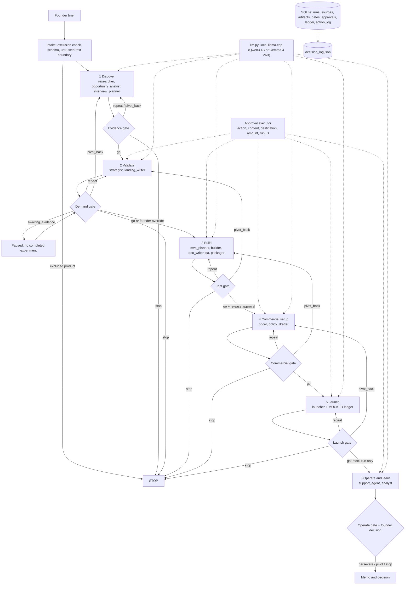
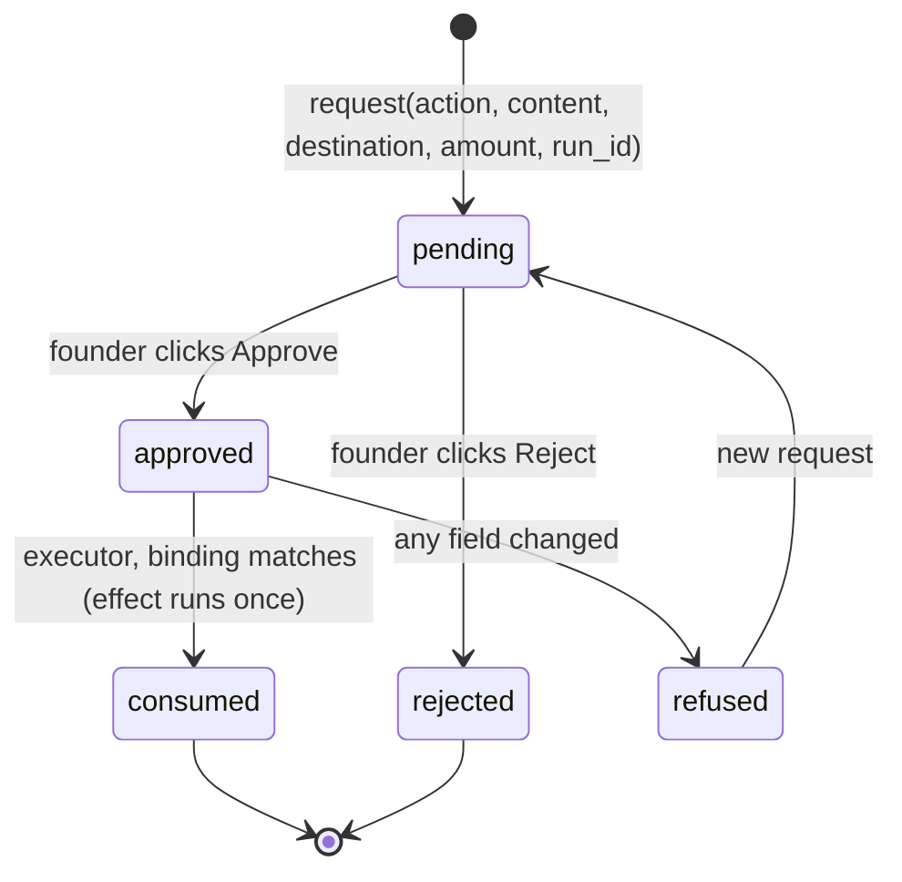
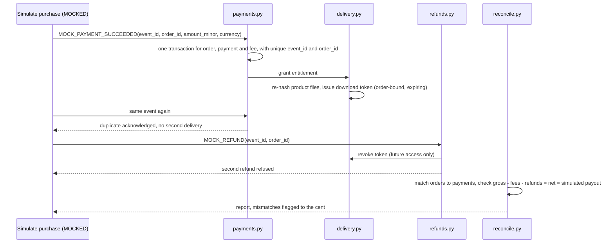
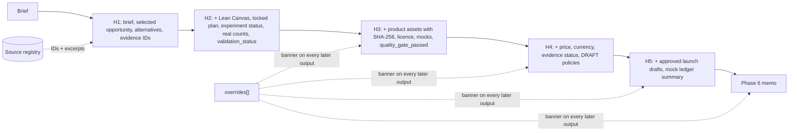

# Architecture

## Overview

The system is an open-source team of AI agents that takes a founder's brief (idea, skills, budget, time, target market, values) through six gated phases: Discover, Validate, Build, Commercial setup, Launch, and Operate and learn. It aims at a validated, sellable **digital** product, and it says "stop" when the evidence is weak. A fixed Python state machine (`orchestrator.py`) runs the phases in order. Each agent is a role function (`agents/<role>.py`) with its own prompt (`prompts/<role>.md`), JSON schema and log entry. The agents only propose text and JSON; plain code decides every gate, checks every rule, and keeps the MOCKED ledger. Publishing and business communications go through the single-use approval executor. The only model is open-weight and runs on the founder's machine, so no brief, excerpt or draft is sent to a model provider. No payment of any kind runs, including sandbox and test mode.

Models: every agent uses one client (`llm.py`) talking to a local llama.cpp `llama-server` (OpenAI-compatible API, JSON-schema constrained output). The default Docker model is **Qwen3 4B Instruct 2507, Q4_K_M** (CPU-friendly); the GPU setup and the committed demo runs use **Gemma 4 26B A4B, Q4_K_M**. Both are Apache 2.0 open weights. There is no hosted tier and no API key; the decision log records the model id the server reports at `/v1/models`. A run ends with a report (Markdown and HTML in `outputs/`, PDF in the app) built by `report.py` from the log. State, sources, approvals and the mock ledger live in SQLite; `decision_log.json` is exported from it.

Design choices in one place (full record with rejected alternatives: [docs/design_decisions.md](docs/design_decisions.md); rule-to-test map: [docs/requirements_traceability.md](docs/requirements_traceability.md)):

| Choice | Decision | Why |
|---|---|---|
| Orchestration | Fixed six-phase state machine, no LLM coordinator | Every transition is known; code-chosen order is cheap, testable and cannot skip a gate |
| Agents | Role functions with typed schemas, called one at a time | Clear roles and logs without agent-to-agent chat |
| Decisions | Code owns exclusions, thresholds, gate outcomes, QA, price math, ledger | Safety and money must not depend on model wording |
| Evidence | Fetched-source registry; the model cites source IDs, code renders URLs | No invented links; unsourced claims become `ASSUMPTION` |
| Approval | One executor checks a single-use binding of action, content hash, destination, amount and run ID | A changed payload or a direct code call cannot pass |
| Models | One local llama.cpp server; no hosted tier | No founder content goes to a model provider; nothing to pay or sign up for; works offline except for search |
| State | SQLite (WAL) on a Docker volume; write-once text outputs | Crash-safe approvals and idempotent mock sales |
| UI | Streamlit on `127.0.0.1:8501` | Single-founder local demo; not a multi-user authorization system |
| Trick prompts | Fixed pattern rules first; then a local-model rule checker (`agents/rule_checker.py`, strict schema) that can only add refusals | Patterns are testable but miss paraphrases (3 of 12 on the held-out set); the model catches wording the patterns never saw, and if it is down the pattern verdict stands and the UI says so |

## Phases

Every phase writes its files to `outputs/` as `phase<N>_step<M>_<name>_<label>_a<attempt>.<ext>` and its gate as `phase<N>_gate_<name>_<label>_a<attempt>.<ext>`, where `<label>` names the run and `<attempt>` the retry. Files are written once and never overwritten. Every agent action appends a log entry with `timestamp`, `agent`, `action`, `sources`, `model`, `cost`, `approved_by` and `run_id`. Every market claim carries a source URL or the label `ASSUMPTION`. Model calls validate against a JSON schema in code; a model failure is never a business verdict.

### Phase 1: Discover

**Core step: Find opportunities.** Sharpen the founder's idea, find sourced pain points, score the idea against two alternatives, define the target segment and market, and prepare Mom Test interviews.

| Item | Detail |
|---|---|
| Agents | `researcher` (search and evidence), `opportunity_analyst` (relevance, comparison, fit), `interview_planner` (Mom Test script) |
| Tools | HN Algolia search, Stack Exchange search, GitHub issues search (keyless, fetched in parallel by code); Wikipedia for background only, never demand evidence; founder-supplied URLs, fetched and registered like any source |
| Model calls | Up to 6: four excerpt batches (≤ 5 excerpts each, ≤ 20 total, picked by a keyword pre-screen in code), one comparison and fit call, one interview-script call (whenever a scored idea can still go forward: `go`, `pivot_back`, or an overridable `stop`, because weak public evidence is exactly when real interviews are needed; thin coverage and non-overridable stops make no model call) |
| Outputs | `phase1_step1_opportunities`, `phase1_step2_evidence.json` (source registry), `phase1_step3_comparison`, `phase1_step4_interview_script`, `phase1_gate_decision` (.md and .json, contract H1) |

Method, in order:

1. **Exclusion check first.** Physical goods, financial, investment or crypto products, and health or legal advice products end in `stop`, which cannot be overridden.
2. **Thresholds logged before searching** (`define_research_criteria`): coverage (at least 2 sources answered, at least 20 items screened), evidence (at least 3 relevant items with URLs across at least 2 sources), fit (at least 3 of 5). All are `ASSUMPTION` planning values fixed before the run.
3. **Search and register.** Each fetched item gets a `source_id` with URL, source, HTTP status, fetch time and excerpt. Items without a URL are dropped; duplicates are merged.
4. **Analyse.** The model receives source IDs and excerpts and returns relevant pains with `source_ids`; its schema has no URL field, so it cannot invent a link. Unknown IDs fail validation.
5. **Compare and score.** The idea and two related opportunities are scored 1 to 5 on skills, budget, time and values with reasons; code computes the weighted score (35/25/25/15). A values conflict blocks regardless of score. Market size stays "unknown" unless a source states it.
6. **Interview plan.** Mom Test questions about specific past behaviour; code drops hypothetical or leading questions, and no answers are invented. The script is the founder's way to turn a `stop` on thin public evidence into real evidence.
7. **Gate** (see Gates).

### Phase 2: Validate

**Core step: Design the business.** Build a Lean Canvas, fix a demand target before any data exists, and prepare a landing-page test the founder runs with real people.

| Item | Detail |
|---|---|
| Agents | `strategist` (Lean Canvas, target lock), `landing_writer` (page copy), `persona_simulator` (optional, founder chooses; output labelled `SIMULATED`, its would-join count stored apart and never counted), `validation_kit` (code) |
| Tools | `gates.lock_target()`, Jinja2 template with autoescape, `guardrails.py`, approval executor, `publish_stub()`, mock waitlist (`MOCKED`), Validation Kit export |
| Model calls | 2 (canvas, page copy), plus 1 if the founder runs the persona stress test. The canvas self-check is done by code: any unsourced box is forced to `ASSUMPTION` |
| Outputs | `phase2_step1_lean_canvas`, `phase2_step2_locked_plan.json`, `phase2_step3_landing_page.html`, `phase2_step4_persona_stress_test` (SIMULATED, optional), `phase2_step6_experiment_plan`, `phase2_step6_tracking.csv`, `phase2_step6_results_form.json`, `phase2_gate_decision` (.md and .json, contract H2) |

Method:

1. **Lean Canvas:** nine boxes, each with Phase 1 source URLs or `ASSUMPTION`; code forces any still-unsourced box to `ASSUMPTION`.
2. **Lock the target:** "N sign-ups in D days" plus `min_visitors`, set by code from configuration and labelled `ASSUMPTION` (defaults follow the organizers' example: 100 in 14 days, 200 visitors). The model never sets the target. Code stores a SHA-256 of the plan and `locked_at` in the log before any page exists.
3. **Landing page:** headline, three benefits tied to cited pains, FAQ. The template has no slots for testimonials, counts, ratings or countdowns, and `guardrails.py` rejects them in free text. Email-only form posting to the mock waitlist; footer "Waitlist: MOCKED".
4. **Publish approval:** action `publish_landing_page`, the page, destination "none: publishing is STUBBED", amount $0.00, run ID. Approval only logs `would_publish`.
5. **Validation Kit:** an experiment plan restating the locked target and its hash, a daily tracking sheet and the results form, whose field names match the gate input.
6. **Real results form:** `experiment_status` (default `not_started`), start and end dates, visitors (default unknown), real sign-ups (default 0). Simulated counts are stored apart and cannot reach the gate.
7. **Gate** (see Gates). With no completed experiment the phase waits; the founder may continue by override, which marks every later output as unvalidated.

### Phase 3: Build

**Core step: Build the product.** Ship a tested MVP with user documentation. Scope for this release: one product shape, the **A1 checklist pack** (Markdown checklist with journey anchors plus a CSV tracker), filled by the model into a team-written template.

| Item | Detail |
|---|---|
| Agents | `mvp_planner`, `builder`, `doc_writer` (model); `qa`, `packager` (code only) |
| Tools | A1 template, Jinja2 renderer with autoescape, QA checks (standard library), SHA-256 manifest, approval executor |
| Model calls | 3: MVP definition, slot content, user docs. Archetype, manifest and traceability matrix come from the A1 template in code |
| Outputs | `phase3_step1_mvp_definition` (plan, journey, traceability matrix), `phase3_step3_product_checklist.md`, `phase3_step3_product_tracker.csv`, `phase3_step3_product_license.txt`, `phase3_step4_user_docs`, `phase3_step5_test_report`, `phase3_gate_decision` (one per attempt), `phase3_step6_handoff.json` (H3, with the release manifest) |

Method:

1. **Entry rule:** runs only after a Phase 2 `go` (mode `mvp`) or a founder override (mode `minimal`: one Must feature, override banner, feedback sheet of past-behaviour questions).
2. **Define the MVP:** one user story, 3 to 6 journey steps, at most 3 Must features each tied to a Phase 1 evidence ID, 3 to 6 Given/When/Then acceptance criteria each mapped to a check or marked `MANUAL`. Thresholds are logged first (`set_phase3_thresholds`).
3. **Build:** the model returns JSON text for named slots; the renderer escapes and inserts it. Model output is never executed; the builder never calls `eval`, `exec` or `subprocess`.
4. **Docs:** six fixed headings in order (Overview, Quick start, How to use, What is mocked, Troubleshooting, Limitations); "What is mocked" is copied from the plan by code, and Quick start links every journey step to its checklist anchor.
5. **Test (no model):** 14 checks apply to A1: manifest complete, size, format validity, journey trace, internal links, no external resources, banned content, excluded category, claims sourced, mocks and override labelled, docs headings, licence, acceptance criteria, naming. Script integrity is not applicable because A1 contains no scripts. A "tested MVP" means all 14 pass and every automated criterion passes; real-user completion stays an unchecked `MANUAL` item.
6. **Release approval:** action `release_product`, content = manifest with hashes, destination "none: internal hand-off to Phase 4", amount $0.00, run ID.

### Phase 4: Commercial setup

**Core step: Set the price and policies.** No payments of any kind.

| Item | Detail |
|---|---|
| Agents | `pricer` (code only: fetch, register, median), `policy_drafter` (model) |
| Tools | Founder-entered competitor quotes with URLs (each page fetched; registered only if it loads; whether the quoted price text appears on the page is recorded), `statistics.median` in code, required-section and compliance-claim checks, approval executor |
| Model calls | 1 (policies); pricing is code |
| Outputs | `phase4_step1_pricing`, `phase4_step2_policy_terms`, `_privacy`, `_refund`, `_delivery`, `phase4_gate_decision`, `phase4_step3_handoff.json` (H4) |

Method:

1. **Pricing:** log `define_pricing_criteria` first; accept only one-time paid prices in one currency with working URLs; price = median of at least 3; free comparables are counted and shown, never dropped. Fewer than 3 → `repeat`; the founder may set an experimental price only by override, labelled `ASSUMPTION` all the way to the store page.
2. **Policies:** Terms (consistent with the MIT product licence), Privacy, Refund, Delivery. Each starts "DRAFT · FOUNDER REVIEW REQUIRED · Not legal advice"; code rejects any compliance claim or banned content.
3. **Commercial approval:** action `commercial_setup`, content = canonical JSON of price and drafts, destination "none: STUBBED (internal hand-off to Phase 5; nothing signed)", amount 0 (no charge is ever made), run ID. Approval releases H4 only; it is not a signature or legal acceptance.

### Phase 5: Launch

**Core steps: Open the store; deliver automatically.** Store page and launch post as drafts behind approval; delivery and payment run on a fully MOCKED local ledger.

| Item | Detail |
|---|---|
| Agents | `launcher` (store page and launch post copy); `payments.py`, `delivery.py`, `refunds.py`, `reconcile.py` are code |
| Tools | Guardrails, approval executor (one approval per item), SQLite ledger, founder's "Simulate purchase (MOCKED)" input |
| Model calls | 2 (store page, launch post); the ledger never calls a model and no ledger data is sent to one |
| Outputs | `phase5_step1_store_page`, `phase5_step2_launch_post`, `phase5_step3_mock_sale`, `phase5_gate_launch` (.md and .json, H5: "go" means mock run only), `outputs/payment_test_log.md` |

Method: each draft gets its own approval with its own destination, both marked "STUBBED · NOT PUBLISHED". After approval of the store page, the mocked sale-to-cash flow runs (see Sale to cash).

### Phase 6: Operate and learn

No Core step. Support users, measure what is real, and write a persevere-or-pivot memo; the founder decides.

| Item | Detail |
|---|---|
| Agents | `support_agent` (FAQ and reply drafts); `analyst` and `gates.operate_gate()` are code |
| Tools | Real-metrics form (founder-entered, evidence link required), Phase 6 targets logged before data, Jinja2 memo template, approval executor for replies |
| Model calls | 1 (FAQ); the memo's numbers, labels and outcome are filled by code |
| Outputs | `phase6_step1_memo` (metrics table and recommendation), `phase6_step2_support_faq`, `phase6_gate_decision` (with the founder's decision) |

Method: every metric is labelled real, `MOCKED` or `SIMULATED`, and only real values reach the recommendation. Support drafts cite the docs or DRAFT policies, are labelled "DRAFT · AI-written for founder review", never speak as the founder or a named person, and send legal, health, financial and refund questions to the founder without advice or promises. Sending a reply is `STUBBED` behind approval. The founder's persevere, pivot or stop choice is logged with `approved_by: "founder"`; if it differs from the recommendation, the memo keeps both.

## Gates

Every phase ends in a gate, and every core step has a step gate recorded the same way. A gate's outcome is one of **go**, **repeat**, **pivot_back** (shown as "pivot back") or **stop**. `awaiting_evidence` is a pause meaning "nothing has been measured yet"; it is not a verdict. Code computes every outcome from thresholds logged before the data; the model only writes the explanation. Each gate writes a plain-language verdict file showing each number against its threshold and what would change the outcome, before any approve or override button.

**Check order in every gate:** (1) hard rules: excluded product, guardrail refusal, target tamper → `stop`; (2) completeness: did the search, experiment or test really happen and cover enough? If not → `repeat` or `awaiting_evidence`, never a negative verdict; (3) locked thresholds; (4) founder action.

| Gate | Checks | go | repeat | pivot_back | stop |
|---|---|---|---|---|---|
| G1 Evidence (Discover) | Coverage, then relevant sourced items, then fit | All pass | Thin coverage after one broadened search (inconclusive); missing brief fields; source outage; model error | Evidence or fit below threshold on adequate coverage, a ranked alternative passes | Excluded product; values conflict; weak evidence or fit on adequate coverage with no alternative left |
| G2 Demand (Validate) | Target hash, experiment status, exposure, ratio r = real sign-ups ÷ N | r ≥ 1 | Experiment abandoned or seen by fewer than `min_visitors`; 0.5 ≤ r < 1 with an attempt left | r < 0.5, or 0.5 ≤ r < 1 after the final attempt, with an alternative left | Same with no alternative left; target tampered |
| G3 Tests (Build) | 14 checks, acceptance criteria | All pass | A check fails, attempt < 3 (failures fed back) | Attempts used up on traceability or format checks: re-plan the MVP from the evidence (once) | Attempts used up with banned content (QA-08) or an excluded category (QA-09); or after the re-plan |
| G4 Commercial | Price evidence, DRAFT labels and sections, approval | All present and approved | < 3 verified paid quotes; missing sections or a compliance claim; founder chooses to re-price | Founder rejects the offer and chooses to change the product → Phase 3 (once) | Founder stops |
| G5 Launch | Per-item approvals, mock ledger checks | Both pass ("mock run only") | Guardrail refusal or a ledger check fails; founder chooses to redraft | Founder rejects a draft and chooses to change the offer → Phase 4 (once) | Founder stops |
| G6 Operate | Real metrics against pre-set targets | All targets met by real values (persevere) | Only mocked or simulated data, or no completed experiment (no recommendation possible) | Target missed, something to pivot to | Targets missed, nothing left |

The Discover and Demand gates never default to `go`.

| Gate | Rule details |
|---|---|
| G2 rows in order | 1 target hash differs → `stop` · 2 status `not_started` or `running` → `awaiting_evidence` · 3 `abandoned` → `repeat`, no attempt used · 4 completed with recorded visitors below `min_visitors` → `repeat`, no attempt used · 5 r ≥ 1 → `go` · 6 0.5 ≤ r < 1, attempt < 2 → `repeat` · 7 r < 0.5 or attempts used, alternative left → `pivot_back` · 8 same, none left → `stop` |
| Settings | Repeat floor 0.5, two completed attempts, coverage 2 sources / 20 items, build attempts 3: all `ASSUMPTION` values set before the run |

**When the system recommends STOP on weak evidence.** Only after the evidence was really examined: Discover with adequate coverage but too few relevant sourced items or too low a fit, once the retry is used and no alternative passes; Validate after a **completed** experiment below target with no alternative left. The organizers' example: target 100 sign-ups in 14 days, 12 real sign-ups, r = 0.12, below the 0.5 floor, so the system recommends pivot back while an alternative remains and stop when none does. The verdict says "not enough evidence to continue", never "no market exists". A source outage, thin coverage, an unrun experiment, a model error or a used-up time budget never produces `stop`.

**Founder override.** After `awaiting_evidence`, `repeat`, `pivot_back` or an evidence-based `stop` in Discover (only when an idea was scored), Validate or the Phase 4 price check, the founder may continue with a typed reason of at least 20 characters. The override is logged, the original verdict stays, an amber bar stays on screen, and every later output starts with "UNVALIDATED · FOUNDER OVERRIDE". It can never pass an excluded product, a guardrail refusal, the Phase 3 test gate, an approval, the payment ban or a failing ledger test.

**Approval.** Approval is separate from gates: a phase `go` authorizes nothing. Each external-effect action (publish, send, release, commercial hand-off, support reply) is queued with its action, content hash, destination, amount and run ID. The founder approves or rejects explicitly; there is no default and no approval on timeout. The executor recomputes the binding, requires an unconsumed approval for the same run, consumes it in the same transaction as the STUBBED or MOCKED effect, and refuses any changed field. Payments, account creation and credential storage cannot be queued at all.

## Sale to cash

Everything here is **MOCKED**: local events in a SQLite ledger. No payment SDK, card field, webhook, sandbox charge, account or transfer exists.

- **Payment triggers delivery.** A `MOCK_PAYMENT_SUCCEEDED` event creates the order, payment, fee (`MOCK_FEE_RATE`) and entitlement in one transaction. Delivery issues a local download token bound to the order and product, with an expiry, after re-hashing the product files against the release manifest.
- **Idempotency prevents double delivery.** `event_id` and `order_id` are unique keys. A repeated event returns the original result and grants nothing new.
- **A refund revokes access.** `MOCK_REFUND` marks the order refunded and revokes the token for future downloads. A copy already downloaded cannot be recalled, and the docs say so. A second refund for the same order is refused.
- **Reconciliation matches orders, payments, fees and payouts.** Amounts are integer minor units. `reconcile()` checks that every order has one payment, that gross minus fees minus refunds equals net, and that net equals a simulated payout batch that never moves money. A one-cent difference is flagged.
- **Proof.** `scripts/payment_test_run.py` runs pay, duplicate pay, refund, duplicate refund, a revoked download and a one-cent mismatch, and writes `outputs/payment_test_log.md` with every line labelled MOCKED.

## Data flow

- **Hand-offs.** Each phase receives a compact typed hand-off (H1 to H5), not the conversation history. Fields are passed on unchanged. Hand-offs and approvals point to the **final** artifact of a step by path and SHA-256; retries write new attempt files and mark older ones superseded.
- **Evidence.** The source registry holds every fetched item (ID, URL, source, status, fetch time, excerpt). Models see IDs and excerpts; the renderer turns IDs into URLs; a claim without a valid ID is printed as `ASSUMPTION`. Mocked and simulated records never count as evidence.
- **Model calls.** `llm.py` sends every call to the local llama.cpp server with the agent's JSON schema as `response_format`, so the server constrains the output. The base URL must be a loopback host or the compose `llm` service; anything else is refused. An earlier design had a hosted NVIDIA tier; it was removed because its requests timed out repeatedly and it would send founder content off the machine.
- **Research requests.** Phase 1 derives a short query from the idea or founder search terms and sends it to HN Algolia, Stack Exchange, GitHub Search and Wikipedia (background only). A founder-supplied URL is fetched directly. The UI discloses these destinations before the founder starts a run.
- **Evidence hygiene.** Identical or near-identical excerpts (Jaccard ≥ 0.85 on word sets) count once. The analyst labels each excerpt `request`, `complaint`, `workaround`, `launch_or_ad` or `other`; only the first three count toward the evidence threshold, because a product launch is supply, not demand. Code also drops feature tickets from developers' own practice, test or hackathon repositories and counts a repeated pain point once. The store page's file list is written by code from the released manifest, so it cannot advertise a file that was never built. If the brief names a country and no counted excerpt mentions it, the segment and market lines say so and label local demand ASSUMPTION.

| Signal | Action |
|---|---|
| Output fails the schema or cites an unknown source ID | One repair attempt with the error appended; at most 4 attempts per call |
| Server rejects an optional parameter or `response_format` (HTTP 400) | Retry once without it, then once with the schema in the prompt only |
| Timeout, HTTP error or the segment budget is used | `repeat` with "nothing decided"; never `stop` |
| GPT-family model id or a non-local base URL | Refused at start-up (team rule) |

- **Time.** Each segment between founder decisions has a time budget (`WORKFLOW_TIME_BUDGET_S`, 1800 s, ASSUMPTION); time spent waiting for the founder is excluded. Measured agent time per run is in the run report.
- **State and logs.** SQLite (WAL mode) on the `app_state` volume holds runs, steps, sources, claims, artifacts, gates, approvals, the mock ledger and `action_log`. `decision_log.json` is exported atomically from `action_log` for the committed demo runs, with the five required keys plus `run_id`, tokens and wall time. Cost is $0.00 because the model is local; it is reported as observed only from a logged run.
- **Runtime.** `docker compose up` starts `llm` (llama.cpp `llama-server`; it loads the GGUF from `LOCAL_MODEL_DIR` when present, otherwise downloads `unsloth/Qwen3-4B-Instruct-2507-GGUF:Q4_K_M` once into a volume) and `app`. The UI opens at once and shows local-model readiness from `/health` while the model loads. Ports bind to `127.0.0.1`. `docker-compose.gpu.yml` switches to the CUDA image and Gemma 4 26B A4B with the team's 16 GB VRAM flags (`-ngl 99 --n-cpu-moe 6 -fa on`, q8_0 KV cache: MoE expert layers that do not fit stay on the CPU). `docker-compose.host-llm.yml` uses a `llama-server` already running on the host (`scripts/start_local_llm.sh`). UI runs write to the `app_state` volume; only the demo runs write the committed `outputs/` and `decision_log.json`.

## Built vs. stubbed

Status words follow one rule: a row says **Working** only when its code exists and its named test passes (`pytest -q`, offline) or a logged run shows it; otherwise it is **Planned**. **MOCKED** means fake data or service in place of a real one; **STUBBED** means the action is never connected and only logs what it would do. The README table "What works and what is mocked" uses the same rows.

| Step | Status | Verified by |
|---|---|---|
| Brief intake, required fields and exclusion check | Working | `test_excluded_brief_stops_not_overridable`, `test_missing_fields_repeat`, `test_brief_e_stops_on_exclusion` |
| Source search and registry (HN Algolia, Stack Exchange, GitHub; Wikipedia background) | Working (offline tests on recorded-style fixtures; live check by `scripts/source_check.py`) | `tests/test_phase1_discover.py` |
| Coverage, evidence and fit gate; opportunity scoring; Mom Test script | Working | `test_thin_coverage_repeats_never_stops`, `test_adequate_coverage_weak_evidence_no_alternative_stops`, `test_interview_drops_hypothetical_questions` |
| Lean Canvas, target lock, landing page with guardrails | Working | `tests/test_phase2_validate.py` |
| Waitlist backend | **MOCKED** (form submits nowhere) | landing page template |
| Publishing the landing page | **STUBBED** behind approval (logs `would_publish`) | `test_publish_blocked_without_approval` |
| Demand gate with `awaiting_evidence` and override | Working | `test_gate_covers_all_branches`, `test_awaiting_without_override_does_not_start_phase3` |
| Real experiment | Run by the founder outside the system; results entered in the form | — |
| Persona stress test | Working (optional); output **SIMULATED**, excluded from the gate | `test_persona_test_is_simulated_and_excluded` |
| MVP build (A1), user docs, 14 QA checks, release approval | Working | `tests/test_phase3_build.py` |
| Product release | Internal hand-off after approval; publishing **STUBBED** | `test_release_needs_approval_and_manifest_change_refused` |
| Pricing (median of ≥ 3 sourced quotes) and DRAFT policies | Working (policies DRAFT, not legal advice) | `tests/test_phase4_commercial.py` |
| Store page and launch post | Drafts working; publishing and posting **STUBBED** behind separate approvals | `test_brief_r_full_run_with_override` |
| Payment, delivery, refund, reconciliation, payout | **MOCKED** (local SQLite events only) | `tests/test_phase5_mock.py`, `outputs/payment_test_log.md` |
| Support FAQ and replies | Drafts working; sending **STUBBED** behind approval | `tests/test_phase6_operate.py` |
| Metrics and persevere-or-pivot memo | Working on real, founder-entered data; mock data never gives persevere | `test_mock_only_never_persevere` |
| Founder approval executor and override | Working | `tests/test_backbone.py` |
| Local model client (llama.cpp) | Working with fake HTTP and a fake local server; real model measured by `scripts/model_check.py` | `tests/test_llm_cascade.py`, `tests/test_local_http.py` |
| Trick-prompt defence (patterns, then a local-model rule check) | Working. Patterns are perfect only on the set they were written from; on a held-out set they caught 3 of 12, which is why the model layer exists and why every output is checked again before approval. Measured numbers: `docs/guardrail_eval.md` | `tests/test_guardrails_eval.py`, `tests/test_rule_checker.py` |
| Final run report (Markdown, HTML, PDF) | Working; built only from the log and the run's files | `tests/test_run_report.py` |
| Streamlit UI (brief, verdict, approval panel, override bar, readiness, readable tables, final report) | Working | `tests/test_ui_smoke.py` |
| G3/G4/G5 `pivot_back` routes | Working | `tests/test_pivot_routes.py` |

Not in this system at all: real payments of any kind, real publishing or posting, real email, account creation, stored passwords or card details, and any claim of legal compliance.

## Roadmap

| When | Item |
|---|---|
| Now (this release) | Six phases with code gates; A1 checklist product; source registry; approval executor; MOCKED sale-to-cash; local llama.cpp model client (Qwen3 4B on CPU, Gemma 4 26B on GPU); final run report; tests and guardrail eval set |
| Next | A CI workflow running `pytest -q` on every push; persona test with several calls instead of one |
| Next | Product shapes A2 (short HTML guide) and A3 (template pack), with script-integrity checks for HTML; more keyless or founder-keyed evidence sources; import of real experiment results from the founder's own form provider, behind approval; measured A/B test of an optional critic for page and store copy |
| Next | Arabic and English output for MENA founders; richer Phase 6 metrics from founder-uploaded exports |
| Later | Authenticated multi-user approvals with roles; consented real integrations (hosting, store listing, email) through the same executor, each still requiring founder approval; reviewed legal policy templates per jurisdiction; A4 static tools |
| Later | Long-term memory across a founder's runs, kept separate from evidence and always labelled |
