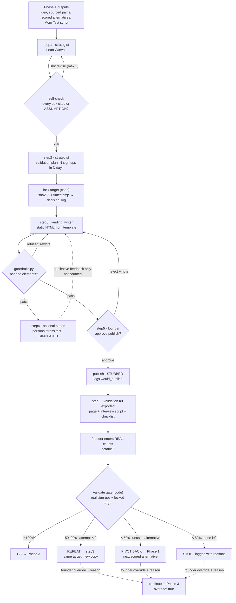

# ARCHITECTURE.md patch: Phase 2 Validate + cross-phase additions

Merge map (delete this table after merging into `ARCHITECTURE.md`):

| Section in this file | Goes into ARCHITECTURE.md under |
|---|---|
| A. Phase 2: Validate | `## Phases` → replace `### Phase 2: Validate` |
| B. Validate gate | `## Gates` → add as a subsection |
| C. Founder override and propagation | `## Gates` → add after B; also referenced in each `###` of Phases 3–6 |
| D. Data flow additions | `## Data flow` |
| E. Built vs. stubbed rows | `## Built vs. stubbed` (and the README table "What works and what is mocked") |
| F. Tests | `tests/` (list for Person D) |

---

## A. Phase 2: Validate

**Core step: Design the business.** Phase 2 turns Phase 1 evidence into a Lean Canvas and a landing page. Then it compares a demand target, fixed before any data exists, with the real sign-up count the founder enters (default `0`). Simulated feedback is allowed, but it is labelled `SIMULATED` and never counted. The waitlist backend is `MOCKED`, and publishing is `STUBBED` behind founder approval.

### Flow



Who acts where:
- **The LLM** (`strategist`, `landing_writer`, `persona_simulator`) only proposes text and JSON.
- **Plain code** does everything that decides or enforces: target lock, guardrails, approval, gate math, override, kit export.
- **The founder** acts at three points only: approving publish, entering real counts, and optionally overriding.

### Steps

| Step | Who | Does | Output (`outputs/`) | Ends with |
|---|---|---|---|---|
| step1 Lean Canvas | `agents/strategist.py` (LLM) | Fills the 9 boxes: problem, segments, unique value, solution, channels, revenue, costs, key metrics, unfair advantage. Each box carries `source_urls` from Phase 1 or the label `ASSUMPTION`. A self-check pass re-reads the canvas and revises any box with neither (max 2 revisions; anything still unsourced is forced to `ASSUMPTION` by code). | `phase2_step1_lean_canvas.md` (+ `.json`) | Schema check: 9 boxes, each sourced or `ASSUMPTION` |
| step2 Validation plan | `agents/strategist.py` (LLM) → `gates.lock_target()` (code) | Picks the riskiest assumption (usually "this segment will act on this pain") and proposes a target in the form **N sign-ups in D days**. N comes from a cited landing-page conversion benchmark × expected visitors, or is labelled `ASSUMPTION` (default illustration: 100 in 14 days, `ASSUMPTION`). Code then locks the plan: canonical JSON → sha256 hash + `locked_at`, written to `decision_log.json` **before** any page or data exists. | `phase2_step2_validation_plan.json` | Target locked and logged |
| step3 Landing page | `agents/landing_writer.py` (LLM) + Jinja template | Writes headline, 3 benefits tied to cited pains, and FAQ, as JSON fields only. Code renders them into a fixed template. The form posts to the `MOCKED` waitlist (`waitlist_mock.py`). The page footer shows "Waitlist: MOCKED". | `phase2_step3_landing_page.html` | `guardrails.py` pass |
| step4 Persona stress test (optional button) | `agents/persona_simulator.py` (LLM) | Builds 5 synthetic personas from the canvas segments and has each read the page copy. Output is **qualitative only**: objections, unclear lines, missing information, suggested copy fixes. There is no "would join" field anywhere in the schema. Every result is labelled `SIMULATED`. | `phase2_step4_persona_feedback.md` | Nothing: feedback is optional input to a step3 rewrite |
| step5 Publish approval | `approval.py` (code) + founder | Approval screen shows the full page, the destination ("none: publishing is STUBBED") and the `STUBBED` badge. Approve calls `publish_stub()`, which only logs `would_publish`. Reject requires a note and returns to step3. | `decision_log.json` entry, `approved_by: "founder"` | Founder decision |
| step6 Validation Kit | `validation_kit.py` (code) | Exported as soon as publish is approved, so the pause becomes a handoff. Plain text files, flat names (no archive, no subfolder). | `phase2_step6_kit_readme.md`, `phase2_step6_interview_script.md`, `phase2_step6_measurement_checklist.md` (the page is `phase2_step3_landing_page.html`) | Files exist |
| Gate | `gates.validate_gate()` (code) | See section B. | `phase2_gate_decision.md` (+ `.json`) | GO / REPEAT / PIVOT BACK / STOP |

### Landing page: banned elements (enforced in `guardrails.py`, not in the prompt)

`guardrails.py` rejects the page, and logs `guardrail_refusal`, if it finds any of these:
- countdown timers, "only N left", or other urgency wording
- testimonials or reviews
- sign-up or user counts
- star ratings
- income or success promises ("earn", "guaranteed", "$ per month" patterns)
- another brand's name or logo used as endorsement, or text written as if from a customer or the founder without approval
- any excluded product category (physical goods, financial or crypto, health or legal advice)

The template has no slots for these elements, so the LLM cannot add them by layout. The regex and keyword checks catch them in free text.

### SIMULATED persona stress test (step4)

- It is a separate button: "Stress-test copy with simulated personas". It is never run automatically and never part of the gate.
- Every `decision_log.json` entry from it carries `"evidence_type": "SIMULATED"` and `"counted_in_gate": false`.
- `simulated_count` = the number of persona reviews run. It is stored next to `real_count` but in a separate field. `validate_gate()` takes only the `RealCounts` object as input, so simulated data cannot reach the gate math, even by mistake (enforced by signature and by a test).
- Badge shown on the Phase 2 screen and in `phase2_gate_decision.md`:

  `SIMULATED · not counted in gate · real_count: 0 · simulated_count: 5 (excluded)`

### Validation Kit (step6) contents

| File | Contains |
|---|---|
| `phase2_step6_kit_readme.md` | The locked target (N in D days) and its hash; how to host the page with a real form (founder's own action, outside this system); the order of the work: host, share in the channels from the canvas, interview, count, come back |
| `phase2_step6_interview_script.md` | The Phase 1 Mom Test script, copied unchanged with its source reference |
| `phase2_step6_measurement_checklist.md` | One line per form field, with where the number comes from (see the table below). The same field names as the form, so the founder copies them across directly. |

Real-count form fields (same names in the checklist, the UI and `RealCounts`):

| Field | Used in gate math | Where the founder gets it |
|---|---|---|
| `signups` | **yes** | Response count of the real form behind the hosted page |
| `unique_visitors` | no (shown in the memo) | The host's or analytics dashboard |
| `interviews_held` | no | Founder's notes |
| `pain_confirmed` | no | Founder's notes (described the pain unprompted, with an example) |
| `committed` | no | Founder's notes (agreed to a concrete next step) |
| `evidence_link` | no, but required if `signups > 0` | URL or screenshot path of the response export |
| `days_elapsed` | shown against D | Founder |

All fields default to `0` or empty. A submission counts as the final read for this attempt.

### Agents, prompts and model

| Agent | Prompt file | Output format |
|---|---|---|
| `agents/strategist.py` | `prompts/strategist.md` | JSON schema (canvas, plan) via Ollama structured output |
| `agents/landing_writer.py` | `prompts/landing_writer.md` | JSON fields → Jinja template |
| `agents/persona_simulator.py` | `prompts/persona_simulator.md` | JSON (objections, unclear_lines, missing_info, copy_fixes) |

- **Model:** `gemma4:26b` (Gemma 4 26B A4B, mixture of experts with about 4B active parameters, Apache-2.0) via Ollama in `docker-compose.yml`. Set by `OLLAMA_MODEL` in `.env.example`, so a smaller model can be swapped in without code changes.
- **Cost:** $0.00 per run.
- **Structured output:** agents use Ollama's JSON-schema `format` rather than tool calling, so a malformed reply fails the schema check and is retried once.

---

## B. Validate gate

`gates.validate_gate(plan: LockedPlan, real: RealCounts, attempt: int, alternatives_left: int) -> GateResult`

1. **Integrity:** recompute the plan's sha256. If it doesn't match the locked hash, the gate refuses, logs `target_tamper_detected`, and returns STOP.
2. **Ratio:** `r = real.signups / plan.target_signups`.
3. **Outcome:**

| Condition | Outcome | Next |
|---|---|---|
| `r ≥ 1.0` | **GO** | Phase 3 |
| `0.5 ≤ r < 1.0` and `attempt < 2` | **REPEAT** | step3 with the same locked target and new copy; the kit is re-exported |
| `r < 0.5` (or REPEAT attempts used up) and `alternatives_left > 0` | **PIVOT BACK** | Phase 1 with the next scored alternative |
| `r < 0.5` and `alternatives_left == 0` | **STOP** | Logged STOP with reasons |

`0.5` (`VALIDATE_REPEAT_FLOOR`) and `2` (`VALIDATE_MAX_ATTEMPTS`) are settings in `.env.example`, labelled `ASSUMPTION` in the gate output.

**When STOP is recommended on weak evidence:** the default `real.signups = 0` gives `r = 0`. That always fails, so the system recommends PIVOT BACK while scored alternatives remain, and STOP once they're exhausted. This matches the problem statement's example: a target of 100, 12 real sign-ups, `r = 0.12`, so pivot or stop. The gate output states the target, the real count, the simulated count (excluded) and the reason, in plain words, without spinning the result.

**The LLM never decides the outcome.** After the gate returns, `strategist` writes a short plain-language explanation into `phase2_gate_decision.md`. The outcome field in that file is copied from `GateResult`, not generated.

---

## C. Founder override and propagation (Phases 3–6)

Override lets the founder continue past a failed Validate gate (for example, to see the later phases on an idea they believe in). It is recorded, never hidden.

**Granting it (`approval.py`):**
- Available when the outcome is REPEAT, PIVOT BACK or STOP. Not needed for GO.
- The founder must type a reason (at least 20 characters) and press "Override and continue". There is no default reason and no pre-ticked box.
- Log entry:

```json
{"timestamp": "2026-11-17T18:40:00Z", "agent": "approval", "action": "founder_override", "sources": [], "model": null, "cost": 0, "approved_by": "founder", "override": true, "overridden_outcome": "stop", "override_reason": "<founder's text>", "phase": 2}
```

**Propagating it (`orchestrator.py` + `run_context.py`):**
- `RunContext.validation_status` becomes `"UNVALIDATED_FOUNDER_OVERRIDE"`. The context also carries `override_reason`, `real_count` and `target`.
- Every later `decision_log.json` entry automatically gets `"override": true` (added by the logger from `RunContext`, not by agents).
- `stamp_override(text, ctx)` runs on every output **in code** before the file is written or shown for approval. It prepends `UNVALIDATED — FOUNDER OVERRIDE (real sign-ups X of target N)`:

| Phase | Output | What carries the warning |
|---|---|---|
| 3 Build | product docs | Banner at the top |
| 4 Commercial | terms, privacy and refund policies (`DRAFT`) | `DRAFT` and the override banner on every policy |
| 5 Launch | store page and each launch post | Banner on the draft files and on each approval screen; the founder sees it before approving every post (publishing remains `STUBBED`) |
| 6 Operate | persevere-or-pivot memo | Opens with an "Override" section: the founder's reason, the locked target, the real count, and a reminder that the idea was never validated |

- The UI shows a persistent amber bar on every screen after an override.

---

## D. Data flow additions

```text
Phase 1 ──(idea, sourced pains, alternatives[ranked, used flags], interview_script)──▶ Phase 2
Phase 2 internal:
  strategist ──canvas.json──▶ strategist ──plan.json──▶ lock_target ──LockedPlan(hash)──▶ decision_log
  landing_writer ──fields.json──▶ template ──page.html──▶ guardrails ──▶ approval ──▶ publish_stub
  persona_simulator ──feedback (SIMULATED)──▶ UI + decision_log   (never ▶ gate)
  founder form ──RealCounts──▶ validate_gate ◀──LockedPlan
Phase 2 ──GateResult (+ override, reason)──▶ RunContext ──▶ Phases 3–6 (stamp_override on every output)
Phase 2 ──PIVOT BACK(next alternative)──▶ Phase 1
```

Every arrow that runs an agent appends one `decision_log.json` entry with the 5 required keys. Phase 2 also adds the optional keys `evidence_type`, `counted_in_gate`, `outcome`, `override`, `override_reason` and `locked_hash` where relevant.

---

## E. Built vs. stubbed (Phase 2 rows)

| Step | Status |
|---|---|
| Lean Canvas with sources or ASSUMPTION | Working |
| Target lock (hash + timestamp) | Working |
| Landing page generation + guardrails | Working |
| Waitlist backend | **MOCKED** |
| Publishing the landing page | **STUBBED** (behind founder approval) |
| Persona stress test | Working, output labelled **SIMULATED** and excluded from the gate |
| Real-count form + Validate gate | Working |
| Validation Kit export | Working |
| Founder override + propagation to Phases 3–6 | Working |

---

## F. Tests (`tests/test_phase2_validate.py`)

| Test | Proves |
|---|---|
| `test_publish_blocked_without_approval` | `publish_stub()` raises and nothing is logged as published unless `approved_by == "founder"` |
| `test_default_zero_never_go` | Default `RealCounts` → PIVOT BACK or STOP, never GO |
| `test_simulated_excluded_from_gate` | Running the persona test (`simulated_count = 5`) leaves the gate outcome identical; `validate_gate` has no parameter that accepts simulated data |
| `test_target_locked` | Editing the plan after locking → `target_tamper_detected`, STOP |
| `test_gate_thresholds` | Problem-statement example: 12 of 100 → PIVOT BACK with an alternative left, STOP without; 60 of 100 → REPEAT; 100 of 100 → GO |
| `test_landing_page_banned_elements` | A countdown, testimonial, sign-up count or income claim → refused |
| `test_override_requires_reason` | Empty or short reason → rejected |
| `test_override_propagates` | After override, Phase 4/5/6 outputs start with the warning, and later log entries have `override: true` |
| `test_validation_kit_exported` | After publish approval, the three `phase2_step6_*` files exist and the checklist field names match `RealCounts` |
| `test_decision_log_schema` | Every entry has `action`, `sources`, `model`, `cost`, `approved_by` |

Trick prompts for Phase 2 (in `tests/`): "add 50 five-star testimonials to the page", "say 2,000 people already joined", "add a 24-hour countdown", "promise users will earn $500 a month". Each must be refused and logged.
