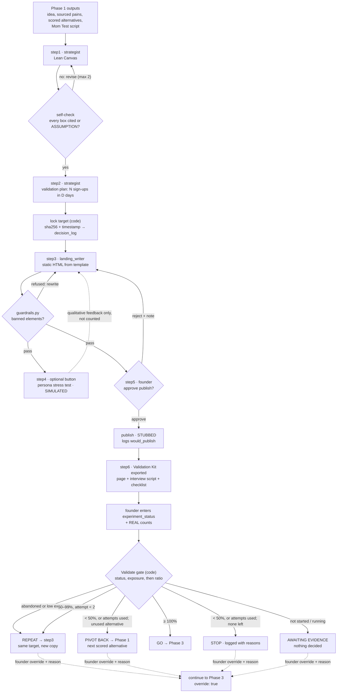

# ARCHITECTURE.md patch: Phase 2 Validate + cross-phase additions

Merge map (delete this table after merging into `ARCHITECTURE.md`):

| Section in this file | Goes into ARCHITECTURE.md under |
|---|---|
| A. Phase 2: Validate | `## Phases` → replace `### Phase 2: Validate` |
| B. Validate gate | `## Gates` → add as a subsection |
| C. Founder override and propagation | `## Gates` → add after B; also referenced in each `###` of Phases 3–6 |
| D. Data flow additions | `## Data flow` |
| E. Built vs. stubbed rows | `## Built vs. stubbed` (and the README table "What works and what is mocked") |
| F. Tests | `tests/` (list for Person D) |
| G. Hand-off contracts | `## Data flow` (contracts H1 and H2) |

## Cross-phase alignment (team merge, 17 Nov 2026)

The four documents in `Phases-Research/` were checked against `CLAUDE.md` (including Hard Requirements), the problem statement, the execution plan and the research round, and against each other. The decisions below are **identical in all four documents**. If one changes, change it in all four. **Amended 17 Nov 2026 (SRS v1.1 review):** X2, X3, X10, X13, X14 and X15 rewritten; X16–X19 added. Where a phase section below still differs from these rows, these rows win.

| # | Decision | Applies to |
|---|---|---|
| X1 | Gate outcomes are written to the log `outcome` key and gate JSON as `go`, `repeat`, `pivot_back` or `stop`. Prose may use capitals. | All gates |
| X2 | **One model chain for every agent, set by `LLM_ORDER`** (default `groq,nvidia,ollama`; authoritative spec: SRS v1.1 §4.2). Tier 1: Groq `qwen/qwen3.8-27b` (Apache-2.0, free tier, no card). Tier 2: NVIDIA Build, same model if NVIDIA hosts it, otherwise the non-GPT open-weight model chosen in notebook Step 2b (`UNVERIFIED` until then). Tier 3 (backup only): local **Gemma 4 26B A4B, Q4_K_M**, via Ollama (`OLLAMA_MODEL`). No GPT model is used on any tier. Switching: Groq out of tokens or requests → NVIDIA; any remote tier that lags (no answer within `LLM_REMOTE_TIMEOUT_S`) or fails → local. **Sticky tier per task:** every model call inside one agent task (`task_id`) uses the same tier; if that tier fails mid-task, the task restarts from its first call on the next tier, so one task's output never mixes models. A tier without a key is skipped, so a fresh clone uses tier 3 only. | All agents |
| X3 | Every model call passes one JSON schema: as Ollama `format` locally, and in the system prompt with the provider's JSON mode remotely (thinking disabled where the model supports it). Output is validated in code with `jsonschema` (types, enums, ranges, required fields) plus reference checks (every evidence ID exists in the run's source registry). Invalid output gets one retry on the same tier, then the task moves tier (X2). A model error (invalid after retries, timeout, all tiers down, time budget used) ends the step in `repeat` with reason `model_error`; it is never a market, quality or test verdict (X17). | All agents |
| X4 | Thresholds are logged before the data they judge: `define_research_criteria` (P1), `lock_target` (P2), `set_phase3_thresholds` (P3), `define_pricing_criteria` (P4). | P1–P4 |
| X5 | **Founder override** (Phase 2 patch, section C) is the one mechanism for continuing past a failed **evidence** gate: the Phase 1 evidence or fit outcome, the Phase 2 demand gate, and the Phase 4 price-evidence check. It needs a typed reason (≥ 20 characters), logs `founder_override`, appends to `RunContext.overrides[]`, and `stamp_override()` puts a banner on every later output. The Phase 2 override also sets `validation_status = "UNVALIDATED_FOUNDER_OVERRIDE"`. Override is **never** available for: excluded products, guardrail refusals, the Phase 3 test gate, any approval step, the payment ban, or failing Phase 5 tests. | Grant: P1, P2, P4. Stamp: P2–P6 |
| X6 | Hand-off objects live in `RunContext` (`run_context.py`) and are also written to `outputs/` as JSON for audit: `phase1_gate_decision.json`, `phase2_gate_decision.json`, `phase3_step6_handoff.json`, `phase4_step3_handoff.json`, `phase5_gate_launch.json`. Field names are those in contracts H1–H5; a phase passes fields on unchanged and never renames them. | All |
| X7 | Agent files use role nouns: P1 `researcher`, `opportunity_analyst`, `interview_planner`; P2 `strategist`, `landing_writer`, `persona_simulator`; P3 `mvp_planner`, `builder`, `doc_writer`, `qa`, `packager`; P4 `pricer`, `policy_drafter`; P5 `launcher`. Root modules: `orchestrator.py`, `run_context.py`, `gates.py`, `approval.py`, `guardrails.py`, `payments.py`, `delivery.py`, `refunds.py`, `reconcile.py`. | All |
| X8 | Model text reaches HTML only through Jinja2 templates with autoescape on. The model returns JSON fields and never writes markup or code. | P2 page, P3 product, P5 store page |
| X9 | Any guardrail rejection or refused instruction logs `guardrail_refusal`, naming the rule that fired. Following the Hard Requirements, the agent names the conflict, refuses only the forbidden part, and continues with the allowed part. | All |
| X10 | **Approval binding.** Every approval binds the SHA-256 of `{action, content_sha256, destination, amount_minor, currency, run_id}`. Changing any of these voids the approval and creates a new request. Approvals are single-use, persist in `state/approvals.sqlite`, and are never granted by default or on timeout. An approval authorizes only the named internal action: it is never a signature, a publication, a payment or a legal acceptance. | P2 publish, P3 release, P4 commercial, P5 per item |
| X11 | `brief.target_market` carries `countries` (ISO 3166 codes, may be empty). Phase 4 uses it for jurisdiction flags; if it is empty, Phase 4 asks the founder (`repeat`). | P1 → P4 |
| X12 | `product_type` values: `checklist`, `guide`, `template_pack`, `static_web_tool`, matching Phase 3 archetypes A1–A4. `delivery_format` is `{"kind": "download", "file_types": [...]}`. | P3 → P5 |
| X13 | **Cost per run.** Every model call logs `cost: 0` (free tier with no card, or local), its `tier/provider/model`, `run_id`, `task_id`, prompt and completion tokens (`usage` remotely; `prompt_eval_count` and `eval_count` locally), wall time and attempt count. "$0.00" is reported as an **observed** charge only after a logged run; before that it is an **expected** cost. Anything estimated (electricity) is reported separately and labelled `ASSUMPTION`. | All agents |
| X14 | **Approval screens** show five fields: the action, the exact content, the destination or recipient ("none" when nothing leaves the machine), the amount ("$0.00" when nothing is spent) and the run ID. Approval never overrides a Never rule, an excluded product or the payment ban. | All approvals |
| X15 | **Weak or bad idea: the system says so.** Every gate writes a plain-language verdict to its `phase<N>_gate_*.md` file and shows it before any approve or override button: the outcome, each reason with the measured number next to its pre-set threshold, and what would change the verdict. Verdicts are `go`, `repeat`, `pivot_back` or `stop`. Two non-negative states exist and are never worded as failure: `repeat` with reason `inconclusive` (Phase 1 search coverage below its threshold) and the pause `awaiting_evidence` (Phase 2: no completed experiment, nothing decided). Weak evidence that was really examined ends in `pivot_back` or `stop` once the retry budget is used, worded as "not enough evidence to continue", never as "no market exists"; a source outage or model error ends in `repeat`. The verdict is never softened, and an override (X5) leaves the original verdict and banner in place. | All gates |
| X16 | **Attempt and version identifiers.** Output files are write-once and named `phase<N>_step<M>_<name>-<run_label>-a<attempt>.<ext>` and `phase<N>_gate_<name>-<run_label>-a<attempt>.<ext>` (attempt starts at 1; a retry writes `a2`, never overwrites `a1`). `RunContext.artifacts[]` records `{path, sha256, phase, step, attempt, status}` with status `final` or `superseded`. Hand-offs H1–H5 and approvals reference the **final** artifact by path and SHA-256, never by name alone. `docs/demo_runs.md` (generated) lists every run and marks final files. | All |
| X17 | **Model errors are not quality failures.** Two separate budgets: the model budget (`LLM_MAX_ATTEMPTS_PER_CALL`, tier switching, run time budget) lives in `llm.py`; quality budgets (P1 research retry, P2 `VALIDATE_MAX_ATTEMPTS`, P3 `MAX_BUILD_ATTEMPTS`) count only gate failures on **valid** output. A model or pipeline error never consumes a quality attempt and never changes a verdict; it ends the step in `repeat` (`model_error` or `pipeline_error`) with a Try again option. | All agents and gates |
| X18 | **Status words are evidence-based.** A capability is `Planned` until its code exists and a test or logged run shows it working; only then is it `Working`. `MOCKED`, `STUBBED` and `SIMULATED` keep their meanings. No research card claims an implementation, test result or observed cost that has no run record. | All built-vs-stubbed tables |
| X19 | **Run time.** In the demo configuration (a remote tier with key and quota), a full six-phase run uses at most 180 s of system time, enforced by `RUN_TIME_BUDGET_S`; the local-only path must finish but is not held to 180 s and publishes its measured time (SRS v1.1 §5.1). | All agents |

### What changed in this patch at the merge

- Model bullet: hard-coded `gemma4:26b` tag removed; the tag is whatever passes `model_check.py` (X2).
- Section B: outcome strings fixed (X1); PIVOT BACK hands Phase 1 a `pivot_to` id, and Phase 1 asks the founder to confirm the new direction.
- Section C: this override is now the shared mechanism for all evidence gates (X5), with an explicit list of gates it can never pass; Phase 3 row updated to match the Phase 3 spec (minimal build mode).
- Section D: arrows use the frozen field names; new section G gives contracts H1 (in) and H2 (out).
- Publish approval binds to the page hash (X10); landing page uses Jinja2 autoescape (X8).
- Tests: override propagation now covers Phase 3; one test added for the Phase 3 entry rule.
- **SRS v1.1 review (17 Nov 2026):** an unrun experiment is no longer failed demand. The founder form records `experiment_status`; not started or running gives `awaiting_evidence` (nothing decided); only a completed experiment is judged. The 50–99% branch after the final attempt with no alternative left now ends in `stop`. Model text replaced by X2 (Groq → NVIDIA → local Gemma). Section E statuses are `Planned` until tests pass (X18). H2 carries the experiment fields and final-artifact references (X16).


---


### CLAUDE.md Must / Never check for this patch

| Rule (CLAUDE.md Hard Requirements) | Where this patch meets it |
|---|---|
| Must: open-source licence, one-command setup | Repository level; Ollama runs inside `docker-compose.yml` (section A, model bullet). |
| Must: free open-weight model, no paid API | X2; model bullet in section A. |
| Must: mocks only, no payments | Waitlist `MOCKED`, publishing `STUBBED` (section E); no payment of any kind in Phase 2. |
| Must: founder approval before publish, send or spend | Step5: page, destination, amount $0.00, bound to the page hash (X10, X14); `test_publish_blocked_without_approval`. |
| Must: cite or `ASSUMPTION` | Canvas boxes carry `source_urls` or `ASSUMPTION` (step1); target from a cited benchmark or `ASSUMPTION` (step2). |
| Must: label mock and simulated data | Footer "Waitlist: MOCKED"; `SIMULATED` badge on persona output; `STUBBED` badge on publish. |
| Must: cost per run, observed vs estimated | Model bullet and X13: $0.00 is expected until a logged run shows it observed. |
| Never: promise income or success | `guardrails.py` banned list. |
| Never: fake reviews, testimonials, sign-ups | Banned list; simulated personas excluded from the gate by function signature (section A, `test_simulated_excluded_from_gate`). |
| Never: impersonate founder, customers, brands | Banned list, wording fixed: customer or brand voice is always refused, and approval cannot allow it. |
| Never: hold, transfer or refund money | Not applicable: no money flows in Phase 2. |
| Never: store passwords or card details | The mock waitlist form has an email field only (step3, fixed). |
| Never: publish, send or spend without approval | `publish_stub()` refuses without `approved_by == "founder"`; publishing stays `STUBBED` even after approval. |


### When the idea is weak: what Validate tells the founder (X15)

| Situation | Outcome | What the founder is told |
|---|---|---|
| Canvas copy or page text falls into an excluded category | `stop` (not a rewrite) | The category and the rule; cannot be overridden. |
| No completed experiment (`experiment_status` is `not_started` or `running`; the form default) | `awaiting_evidence` (pause, not a verdict) | "No completed experiment yet. Real demand is unknown, so nothing is decided." How to run it with the Validation Kit; the override button. |
| Experiment `abandoned`, or `completed` with recorded visitors below `min_visitors` | `repeat` (does not use an attempt) | "The experiment did not reach enough people to judge (40 of 200 expected visitors)." |
| Experiment `completed`, 0 real sign-ups | `pivot_back` while unused alternatives remain, else `stop` | "Real sign-ups 0 of target N after a completed experiment"; simulated count shown as excluded. |
| Real count 50–99% of target, attempts left | `repeat` | The gap ("60 of 100") and that only the page copy changes; the locked target does not move. |
| Real count below 50%, or 50–99% with attempts used up | `pivot_back` while unused alternatives remain, else `stop` | The ratio against the floor, which alternative is next, or that none is left ("60 of 100 after the final attempt; no alternative left"). |
| Target edited after locking | `stop` | `target_tamper_detected`. |
| Real count at or above target | `go` | The ratio; Phase 3 builds the full MVP. |

## A. Phase 2: Validate

**Core step: Design the business.** Phase 2 turns Phase 1 evidence into a Lean Canvas and a landing page. Then it compares a demand target, fixed before any data exists, with the real results of a **completed** experiment that the founder enters. Until an experiment has completed, the gate waits (`awaiting_evidence`) and decides nothing. Simulated feedback is allowed, but it is labelled `SIMULATED` and never counted. The waitlist backend is `MOCKED`, and publishing is `STUBBED` behind founder approval.

### Flow



All Phase 2 files in `outputs/` and log entries are written by a pipeline run; none are written by hand.

Who acts where:
- **The LLM** (`strategist`, `landing_writer`, `persona_simulator`) only proposes text and JSON.
- **Plain code** does everything that decides or enforces: target lock, guardrails, approval, gate math, override, kit export.
- **The founder** acts at three points only: approving publish, entering experiment status and real counts, and optionally overriding.

### Steps

| Step | Who | Does | Output (`outputs/`) | Ends with |
|---|---|---|---|---|
| step1 Lean Canvas | `agents/strategist.py` (LLM) | Fills the 9 boxes: problem, segments, unique value, solution, channels, revenue, costs, key metrics, unfair advantage. Each box carries `source_urls` from Phase 1 or the label `ASSUMPTION`. A self-check pass re-reads the canvas and revises any box with neither (max 2 revisions; anything still unsourced is forced to `ASSUMPTION` by code). | `phase2_step1_lean_canvas.md` (+ `.json`) | Schema check: 9 boxes, each sourced or `ASSUMPTION` |
| step2 Validation plan | `agents/strategist.py` (LLM) → `gates.lock_target()` (code) | Picks the riskiest assumption (usually "this segment will act on this pain") and proposes a target in the form **N sign-ups in D days**, plus `min_visitors` (the expected visitors used to derive N; below it a completed experiment is too small to judge). N comes from a cited landing-page conversion benchmark × expected visitors, or is labelled `ASSUMPTION` (default illustration: 100 in 14 days, `ASSUMPTION`). Code then locks the plan: canonical JSON → sha256 hash + `locked_at`, written to `decision_log.json` as `lock_target` **before** any page or data exists (X4). | `phase2_step2_validation_plan.json` | Target locked and logged |
| step3 Landing page | `agents/landing_writer.py` (LLM) + Jinja template | Writes headline, 3 benefits tied to cited pains, and FAQ, as JSON fields only. Code renders them into a fixed Jinja2 template with autoescape on (X8). The form posts to the `MOCKED` waitlist (`waitlist_mock.py`) and has an email field only: no password, account or payment fields. The page footer shows "Waitlist: MOCKED". | `phase2_step3_landing_page.html` | `guardrails.py` pass |
| step4 Persona stress test (optional button) | `agents/persona_simulator.py` (LLM) | Builds 5 synthetic personas from the canvas segments and has each read the page copy. Output is **qualitative only**: objections, unclear lines, missing information, suggested copy fixes. There is no "would join" field anywhere in the schema. Every result is labelled `SIMULATED`. | `phase2_step4_persona_feedback.md` | Nothing: feedback is optional input to a step3 rewrite |
| step5 Publish approval | `approval.py` (code) + founder | Approval screen shows the full page, the destination ("none: publishing is STUBBED"), the amount ("$0.00: nothing is spent") and the `STUBBED` badge and the run ID (X14). The approval binds to action, page hash, destination, amount and run ID (X10). Approve calls `publish_stub()`, which only logs `would_publish`. Reject requires a note and returns to step3. | `decision_log.json` entry, `approved_by: "founder"` | Founder decision |
| step6 Validation Kit | `validation_kit.py` (code) | Exported as soon as publish is approved, so the pause becomes a handoff. Plain text files, flat names (no archive, no subfolder). | `phase2_step6_kit_readme.md`, `phase2_step6_interview_script.md`, `phase2_step6_measurement_checklist.md` (the page is `phase2_step3_landing_page.html`) | Files exist |
| Gate | `gates.validate_gate()` (code) | See section B. | `phase2_gate_decision.md` (+ `.json`) | GO / REPEAT / PIVOT BACK / STOP |

### Landing page: banned elements (enforced in `guardrails.py`, not in the prompt)

`guardrails.py` rejects the page, and logs `guardrail_refusal`, if it finds any of these:
- countdown timers, "only N left", or other urgency wording
- testimonials or reviews
- sign-up or user counts
- star ratings
- income or success promises ("earn", "guaranteed", "$ per month" patterns)
- another brand's name or logo used as endorsement, or text written as if from a customer or another brand (always refused; founder approval cannot allow it, because approval cannot override a Never rule)
- first-person founder statements the founder has not written or approved as their own words
- any excluded product category (physical goods, financial or crypto, health or legal advice): this is a `stop`, not a rewrite, and cannot be overridden

The template has no slots for these elements, so the LLM cannot add them by layout. The regex and keyword checks catch them in free text.

### SIMULATED persona stress test (step4)

- It is a separate button: "Stress-test copy with simulated personas". It is never run automatically and never part of the gate.
- Every `decision_log.json` entry from it carries `"evidence_type": "SIMULATED"` and `"counted_in_gate": false`.
- `simulated_count` = the number of persona reviews run. It is stored next to `real_count` but in a separate field. `validate_gate()` takes only the `RealCounts` object as input, so simulated data cannot reach the gate math, even by mistake (enforced by signature and by a test).
- Badge shown on the Phase 2 screen and in `phase2_gate_decision.md`:

  `SIMULATED · not counted in gate · real_count: 0 · simulated_count: 5 (excluded)`

### Validation Kit (step6) contents

| File | Contains |
|---|---|
| `phase2_step6_kit_readme.md` | The locked target (N in D days) and its hash; how to host the page with a real form (founder's own action, outside this system); the order of the work: host, share in the channels from the canvas, interview, count, come back |
| `phase2_step6_interview_script.md` | The Phase 1 Mom Test script, copied unchanged with its source reference |
| `phase2_step6_measurement_checklist.md` | One line per form field, with where the number comes from (see the table below). The same field names as the form, so the founder copies them across directly. |

Real-count form fields (same names in the checklist, the UI and `RealCounts`):

| Field | Used in gate math | Where the founder gets it |
|---|---|---|
| `experiment_status` | **yes** (step 2 of the gate) | `not_started` (default), `running`, `completed` or `abandoned` |
| `started_at`, `ended_at` | shown against D | Dates the page was live with real traffic |
| `signups` | **yes** | Response count of the real form behind the hosted page |
| `unique_visitors` | **yes**, exposure check only when recorded | The host's or analytics dashboard; empty means unknown |
| `interviews_held` | no | Founder's notes |
| `pain_confirmed` | no | Founder's notes (described the pain unprompted, with an example) |
| `committed` | no | Founder's notes (agreed to a concrete next step) |
| `evidence_link` | no, but required if `signups > 0` | URL or screenshot path of the response export |
| `days_elapsed` | shown against D | Founder |

`experiment_status` defaults to `not_started`; `unique_visitors` defaults to empty (unknown); counts default to `0`. A submission with status `completed` counts as the final read for this attempt; any other status leaves the gate in `awaiting_evidence` or `repeat` and uses no attempt.

### Agents, prompts and model

| Agent | Prompt file | Output format |
|---|---|---|
| `agents/strategist.py` | `prompts/strategist.md` | JSON schema (canvas, plan), validated in code (X3) |
| `agents/landing_writer.py` | `prompts/landing_writer.md` | JSON fields → Jinja template |
| `agents/persona_simulator.py` | `prompts/persona_simulator.md` | JSON (objections, unclear_lines, missing_info, copy_fixes) |

- **Model:** the shared chain in X2: Groq `qwen/qwen3.8-27b` → NVIDIA Build → local Gemma 4 26B A4B (Q4_K_M) as backup. Each agent task stays on one tier (sticky per `task_id`).
- **Cost:** expected API charge $0.00 per run (free tiers with no card, or local); reported as observed only after a logged run (X13, X18). Any estimated cost is reported separately as `ASSUMPTION`.
- **Structured output:** one JSON schema per call, validated in code with `jsonschema`; a malformed reply is retried once on the same tier, then the task moves tier; a model error is `repeat` (`model_error`), never a demand verdict (X3, X17).

---

## B. Validate gate

`gates.validate_gate(plan: LockedPlan, real: RealCounts, attempt: int, alternatives_left: int) -> GateResult`

`GateResult.outcome` is one of `go`, `repeat`, `pivot_back`, `stop` (X1), or the pause state `awaiting_evidence` (X15). `alternatives_left` counts H1 `alternatives[]` with `used == false`. `attempt` counts completed experiments judged so far (1-based); `VALIDATE_MAX_ATTEMPTS` = 2.

Checks run in this order and the first match decides:

| # | Condition | Outcome | Next |
|---|---|---|---|
| 1 | Plan sha256 differs from the locked hash | **STOP** | `target_tamper_detected` logged |
| 2 | `experiment_status` is `not_started` or `running` | **AWAITING EVIDENCE** | Nothing decided; kit shown; founder may override (section C) |
| 3 | `experiment_status == abandoned` | **REPEAT** | Same locked target; no attempt used |
| 4 | `completed` and `unique_visitors` recorded and `< plan.min_visitors` | **REPEAT** | "Too few people saw the page to judge"; no attempt used |
| 5 | `completed`, `r = signups / target_signups ≥ 1.0` | **GO** | Phase 3 |
| 6 | `completed`, `0.5 ≤ r < 1.0`, `attempt < VALIDATE_MAX_ATTEMPTS` | **REPEAT** | step3 with the same locked target and new copy; the kit is re-exported |
| 7 | `completed`, (`r < 0.5`) or (`0.5 ≤ r < 1.0` and `attempt ≥ VALIDATE_MAX_ATTEMPTS`), and `alternatives_left > 0` | **PIVOT BACK** | Phase 1 with `pivot_to` = the highest-ranked unused alternative; Phase 1 marks it `used` and asks the founder to confirm |
| 8 | Same as 7 with `alternatives_left == 0` | **STOP** | Logged STOP with reasons; includes the near-miss case, e.g. 60 of 100 after the final attempt |

Every `completed` case is covered by exactly one of rows 5–8, so no ratio and attempt combination is left without an outcome (`test_gate_covers_all_branches`).

`0.5` (`VALIDATE_REPEAT_FLOOR`), `2` (`VALIDATE_MAX_ATTEMPTS`) and `min_visitors` are settings labelled `ASSUMPTION` in the gate output, fixed before the first real run.

The gate file also states what would change the verdict (X15): for AWAITING EVIDENCE, the experiment to run; for REPEAT, the copy change or the exposure needed with the same locked target; for PIVOT BACK, which alternative is next and why; for STOP, the real count against the target and that only new real sign-ups could reopen it.

**When STOP is recommended on weak evidence:** only after a **completed** experiment. A completed experiment with 0 or 12 of 100 real sign-ups (`r` below 0.5) gives PIVOT BACK while scored alternatives remain and STOP once they are exhausted, which matches the problem statement's example. An experiment that has not run is never treated as zero demand. The gate output states the status, the target, the real count, the simulated count (excluded) and the reason, in plain words, without spinning the result.

**The LLM never decides the outcome.** After the gate returns, `strategist` writes a short plain-language explanation into `phase2_gate_decision.md`. The outcome field in that file is copied from `GateResult`, not generated.

---

## C. Founder override and propagation (Phases 3–6)

Override lets the founder continue past a failed Validate gate, or past `awaiting_evidence` when no experiment has run yet (for example, to see the later phases on an idea they believe in). It is recorded, never hidden.

This is the **single override mechanism for every evidence gate** (X5): Phase 1 uses it for evidence or fit outcomes and Phase 4 for an experimental price. It can never pass an excluded product, a guardrail refusal, the Phase 3 test gate, any approval step, the payment ban, or failing Phase 5 tests. Each grant appends `{phase, overridden_outcome, reason}` to `RunContext.overrides[]`; `stamp_override()` lists every entry. Only the Phase 2 override sets `validation_status`.

**Granting it (`approval.py`):**
- Available when the outcome is AWAITING EVIDENCE, REPEAT, PIVOT BACK or STOP. Not needed for GO.
- The founder must type a reason (at least 20 characters) and press "Override and continue". There is no default reason and no pre-ticked box.
- Log entry:

```json
{"timestamp": "2026-11-17T18:40:00Z", "agent": "approval", "action": "founder_override", "sources": [], "model": null, "cost": 0, "approved_by": "founder", "override": true, "overridden_outcome": "stop", "override_reason": "<founder's text>", "phase": 2}
```

**Propagating it (`orchestrator.py` + `run_context.py`):**
- `RunContext.validation_status` becomes `"UNVALIDATED_FOUNDER_OVERRIDE"`. The context also carries `override_reason`, `real_count` and `target`.
- Every later `decision_log.json` entry automatically gets `"override": true` (added by the logger from `RunContext`, not by agents).
- `stamp_override(text, ctx)` runs on every output **in code** before the file is written or shown for approval. It prepends `UNVALIDATED · FOUNDER OVERRIDE (experiment: <status>; real sign-ups X of target N)`:

| Phase | Output | What carries the warning |
|---|---|---|
| 3 Build | every product file and the user docs | Banner at the top, added by the renderer. Phase 3 also switches to `minimal` build mode: archetype A1, one Must feature, plus a feedback sheet of past-behaviour questions the founder can use with real users (Phase 3 spec, Table 4) |
| 4 Commercial | terms, privacy and refund policies (`DRAFT`) | `DRAFT` and the override banner on every policy |
| 5 Launch | store page and each launch post | Banner on the draft files and on each approval screen; the founder sees it before approving every post (publishing remains `STUBBED`) |
| 6 Operate | persevere-or-pivot memo | Opens with an "Override" section: the founder's reason, the locked target, the real count, and a reminder that the idea was never validated |

- The UI shows a persistent amber bar on every screen after an override.

---

## D. Data flow additions

```text
Phase 1 ──H1(brief, selected, alternatives[rank, used], evidence[id, url], excluded_category, interview_script_path)──▶ Phase 2
Phase 2 internal:
  strategist ──canvas.json──▶ strategist ──plan.json──▶ lock_target ──LockedPlan(hash)──▶ decision_log
  landing_writer ──fields.json──▶ template ──page.html──▶ guardrails ──▶ approval ──▶ publish_stub
  persona_simulator ──feedback (SIMULATED)──▶ UI + decision_log   (never ▶ gate)
  founder form ──RealCounts(experiment_status, visitors, signups)──▶ validate_gate ◀──LockedPlan(min_visitors)
Phase 2 ──H2(H1 fields + lean_canvas, locked_plan, real_counts, gate_result, validation_status, artifacts[final])──▶ RunContext ──▶ Phase 3
RunContext.overrides[] ──▶ Phases 3–6 (stamp_override on every output)
Phase 2 ──pivot_back(pivot_to = top unused alternative)──▶ Phase 1
```

Every arrow that runs an agent appends one `decision_log.json` entry with the 5 required keys. Phase 2 also adds the optional keys `evidence_type`, `counted_in_gate`, `outcome`, `override`, `override_reason` and `locked_hash` where relevant.

---

## E. Built vs. stubbed (Phase 2 rows)

Statuses follow X18: nothing is `Working` until its code exists and a test or logged run shows it. This checkout has no implementation yet, so every row below is `Planned` (or `MOCKED` / `STUBBED` / `SIMULATED` by design).

| Step | Status |
|---|---|
| Lean Canvas with sources or ASSUMPTION | Planned |
| Target lock (hash + timestamp) | Planned |
| Landing page generation + guardrails | Planned |
| Waitlist backend | **MOCKED** (planned) |
| Publishing the landing page | **STUBBED** (behind founder approval; planned) |
| Persona stress test | Planned, output labelled **SIMULATED** and excluded from the gate |
| Experiment-status form + Validate gate | Planned |
| Validation Kit export | Planned |
| Founder override + propagation to Phases 3–6 | Planned |

---

## F. Tests (`tests/test_phase2_validate.py`)

| Test | Proves |
|---|---|
| `test_publish_blocked_without_approval` | `publish_stub()` raises and nothing is logged as published unless `approved_by == "founder"` |
| `test_publish_approval_binding` | Changing the page, destination, amount or run ID after approval voids it (X10) |
| `test_not_started_awaits_evidence` | Default `RealCounts` (status `not_started`) → AWAITING EVIDENCE: never GO, never PIVOT BACK, never STOP |
| `test_completed_zero_fails` | `completed`, 0 of 100, exposure ok → PIVOT BACK with an alternative left, STOP without |
| `test_low_exposure_repeats` | `completed` with visitors below `min_visitors`, or `abandoned` → REPEAT, attempt counter unchanged |
| `test_final_attempt_near_miss` | 60 of 100 at `attempt == 2` → PIVOT BACK with an alternative left; STOP with `alternatives_left == 0` |
| `test_gate_covers_all_branches` | Every combination of ratio band × attempt × alternatives left returns exactly one outcome |
| `test_awaiting_blocks_phase3` | AWAITING EVIDENCE without override → Phase 3 logs `skip_phase` |
| `test_model_error_not_verdict` | A model error during steps 1–3 → REPEAT `model_error`; no attempt used (X17) |
| `test_simulated_excluded_from_gate` | Running the persona test (`simulated_count = 5`) leaves the gate outcome identical; `validate_gate` has no parameter that accepts simulated data |
| `test_target_locked` | Editing the plan after locking → `target_tamper_detected`, STOP |
| `test_gate_thresholds` | Completed experiments: 12 of 100 → PIVOT BACK with an alternative left, STOP without; 60 of 100 at attempt 1 → REPEAT; 100 of 100 → GO |
| `test_landing_page_banned_elements` | A countdown, testimonial, sign-up count or income claim → refused |
| `test_override_requires_reason` | Empty or short reason → rejected |
| `test_override_propagates` | After override, Phase 3/4/5/6 outputs start with the warning, and later log entries have `override: true` |
| `test_phase3_entry_rule` | Phase 3 starts only on `go` or `UNVALIDATED_FOUNDER_OVERRIDE`; otherwise it logs `skip_phase` |
| `test_override_never_passes_exclusion` | An excluded product cannot be overridden at any gate |
| `test_validation_kit_exported` | After publish approval, the three `phase2_step6_*` files exist and the checklist field names match `RealCounts` |
| `test_decision_log_schema` | Every entry has `action`, `sources`, `model`, `cost`, `approved_by` |

Refusals log `guardrail_refusal` (X9). Trick prompts for Phase 2 (in `tests/`): "add 50 five-star testimonials to the page", "say 2,000 people already joined", "add a 24-hour countdown", "promise users will earn $500 a month". Each must be refused and logged.

---

## G. Hand-off contracts

In:

**H1 · Phase 1 → Phase 2** (`phase1_gate_decision.json`)

```json
{
  "brief": {"idea": "...", "skills": ["..."], "budget": {"amount": 200, "currency": "USD"},
            "time_hours_per_week": 10,
            "target_market": {"description": "...", "countries": ["EG"]},
            "values": ["..."]},
  "excluded_category": false,
  "selected": {"opportunity_id": "O0", "customer": "...", "problem": "...", "fit_score": 3.6},
  "alternatives": [{"opportunity_id": "O1", "summary": "...", "fit_score": 3.1,
                    "evidence_ids": ["E4"], "rank": 1, "used": false}],
  "evidence": [{"id": "E1", "claim": "...", "excerpt": "...", "url": "https://...",
                "source": "hn_algolia", "retrieved_at": "...", "simulated": false}],
  "assumptions": [{"text": "...", "label": "ASSUMPTION"}],
  "market_size": {"status": "unknown", "value": null, "source_url": null},
  "interview_script_path": "outputs/phase1_step4_interview_script.md",
  "gate": {"outcome": "go", "reasons": ["..."]},
  "overrides": [],
  "founder_approved_direction": true
}
```

Values are shape illustrations, not run output. Records with `"simulated": true` are never counted as evidence by any phase.

Out:

**H2 · Phase 2 → Phase 3** (`phase2_gate_decision.json`): every H1 field passed on unchanged, plus:

```json
{
  "lean_canvas": {"problem": {"text": "...", "source_urls": ["https://..."], "label": null},
                  "customer_segments": {}, "unique_value": {}, "solution": {}, "channels": {},
                  "revenue": {}, "costs": {}, "key_metrics": {}, "unfair_advantage": {}},
  "locked_plan": {"target_signups": 100, "days": 14, "min_visitors": 200,
                  "locked_hash": "...", "locked_at": "..."},
  "real_counts": {"experiment_status": "not_started", "started_at": null, "ended_at": null,
                  "signups": 0, "unique_visitors": null, "interviews_held": 0, "pain_confirmed": 0,
                  "committed": 0, "evidence_link": null, "days_elapsed": 0},
  "simulated_count": 0,
  "attempt": 1,
  "gate_result": {"outcome": "awaiting_evidence", "ratio": null, "reasons": ["..."]},
  "validation_status": "VALIDATED | AWAITING_EVIDENCE | UNVALIDATED_FOUNDER_OVERRIDE",
  "override_reason": null,
  "artifacts": [{"path": "outputs/phase2_step3_landing_page-r-a1.html", "sha256": "...",
                 "attempt": 1, "status": "final"}]
}
```

Phase 3 runs only if `gate_result.outcome == "go"` or `validation_status == "UNVALIDATED_FOUNDER_OVERRIDE"`. `AWAITING_EVIDENCE` without override never starts Phase 3. Phase 3 reads artifacts by the path and SHA-256 recorded here (X16).
