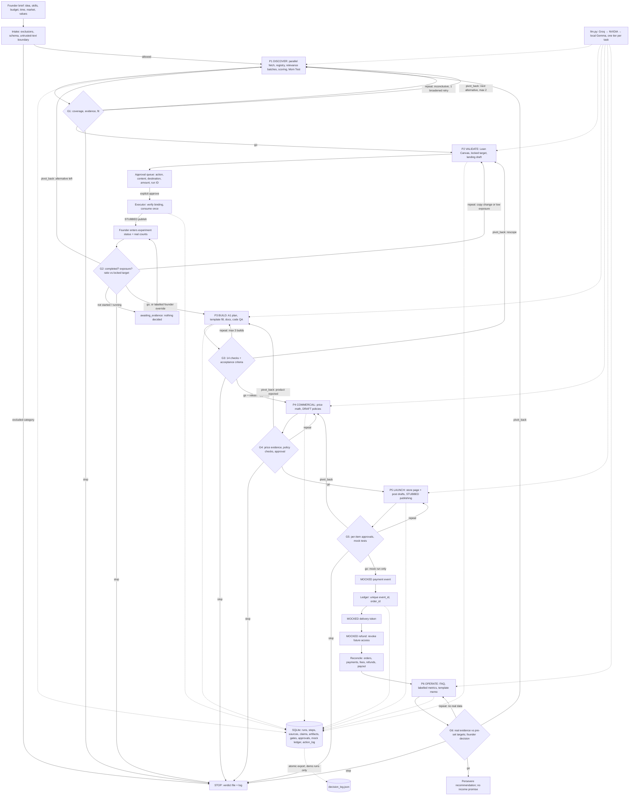

# Architecture decision report (aligned): MADS × CSEA Venture Builders

**Decision date:** 17 November 2026
**Version:** 2, aligned with the requirements on 17 November 2026
**Status:** implemented on 17 Nov 2026 with the changes in rows A17 to A19 (full list: SRS v1.4 Appendix F); benchmarks come from the logged demo runs
**Decision horizon:** four Python developers; about seven build hours; final submission tonight
**Authority, in order:** (1) `CLAUDE.md`, including its Hard Requirements, and the organizers' problem statement; (2) **SRS v1.1** (the requirements base) and the shared cross-phase decisions X1–X19 in `Phases-Research/`; (3) this report; (4) Build Runbook v3.1 (planning input). Where this report and SRS v1.1 differed, the SRS was kept unless the difference exposed a real problem; those cases are listed in section 0 with the fix.

## 0. Alignment record (what changed from version 1 and why)

Version 1 of this report was written against an older instruction that asked for a local-only Ollama default. The requirements have since been fixed in SRS v1.1, so the report is aligned to them below. Each row says which document wins and, where the report found a real gap in the requirements, how it is solved.

| # | Topic | Version 1 said | Requirements (SRS v1.1) say | Decision now |
|---|---|---|---|---|
| A1 | Model access | Ollama only, `qwen3:4b` default; do not build the remote cascade | Groq `qwen/qwen3.8-27b` → NVIDIA Build → local Gemma 4 26B A4B Q4_K_M (backup); no GPT; sticky tier per task (MOD-1 to MOD-11, X2) | **Requirements win.** CLAUDE.md allows "locally or on a free tier", and the problem statement lists Qwen among free models. Version 1's concerns are kept as constraints: the no-key fresh clone still runs fully on the local tier, all cascade tests use fake HTTP, and remote tiers receive demo briefs only (SEC-3). |
| A2 | Local hardware | CPU laptop, 8–30 tokens/s assumed | Team laptop GPU corrected to **16 GB VRAM** (founder, 17 Nov) | Gemma 4 26B A4B Q4_K_M weights are about 16–17 GB, so on 16 GB VRAM a small part (about 1–2 GB at 8K context) spills to system RAM; third-party reports give roughly 40–70 tokens/s on 16 GB cards. **Issue found and solved:** if the spill makes local calls slow, use a smaller quantization of the same model (Q4_K_S about 14.9 GB, or UD-IQ4_XS about 12.7 GB) that fits fully; the model and X2 do not change. Judges' machines may be CPU-only, so the compose default stays CPU-safe and the GPU file is an override. |
| A3 | Outcome spelling | `pivot` stored; `pivot_back` normalized in the UI | `pivot_back` stored (X1); problem statement says "pivot back" | **Requirements win.** Stored value `pivot_back`, shown as "pivot back". `awaiting_evidence` is a pause, not a verdict (both agree). |
| A4 | Output names | Run label before the extension | `<name>-<label>-a<attempt>` (X16) | **Requirements win**: attempt numbers are needed so retries inside one run never overwrite earlier files. |
| A5 | Model retries | At most 2 generated attempts per call | 1 retry per tier, at most 4 attempts across tiers, tier switch on lag (MOD-7, MOD-8) | Both kept: at most 2 generated attempts **per tier** (1 + 1 repair), at most 4 per call across tiers, all inside the run time budget. |
| A6 | Demand gate example | Target 25 sign-ups / 100 visitors; 12 → 0.48 | Problem statement: target 100 sign-ups in 14 days, 12 real → pivot or stop | **Requirements win.** The example uses the organizers' numbers: 12 ÷ 100 = 0.12, below the 0.5 floor, so `pivot_back` while an alternative remains, else `stop`. |
| A7 | Phase 4 missing price evidence | "hold price as explicit assumption" | Fewer than 3 quotes → `repeat`; experimental price only through founder override labelled ASSUMPTION (COM-1) | **Requirements win**: the code never sets an assumed price by itself. |
| A8 | Phase 4 pivot target | Back to Validate | Back to Phase 3 when the founder rejects the product (Phase 4 card) | **Requirements win.** |
| A9 | Phase 3 calls | 3 (plan, slot fill, docs) | Phase 3 spec had planner calls for 3.1 and 3.2 | **Report wins, no conflict:** with the A1-only scope (BLD-0), step 3.2 needs no model call: archetype, manifest and traceability matrix come from the A1 template in code. 3 calls. |
| A10 | Phase 6 memo | Deterministic template, 0 calls | Card had model wording around code numbers (OPS-5 only requires code-copied numbers) | **Report wins, no conflict:** the memo is a Jinja template filled by code; the only Phase 6 call is the support FAQ. Phase 6 card updated. |
| A11 | Run time | Full run 6–30+ min on CPU | 180 s system time in the demo configuration (PERF-1, PERF-2) | **Requirements win**, and the report found a real gap: **Groq's free tier allows 8K tokens per minute**, but a full run is about 27K tokens, so Groq alone cannot finish a run in 180 s. **Solution:** the pre-emptive token check (MOD-4) moves tasks to NVIDIA as soon as Groq's minute budget is low; output caps and thinking-off keep tokens down; PERF-1 is measured on brief R and, if it fails, calls are merged before the limit is touched. The local path (16 GB GPU) is measured separately (PERF-5). |
| A12 | Audit log | SQLite canonical; `decision_log.json` exported atomically | JSON log appended atomically (LOG-1) | **Report wins, no conflict:** SQLite `action_log` is canonical for crash safety; `decision_log.json` is exported atomically from it, filtered to the committed demo runs so the file stays small (CLAUDE.md). The five required keys are unchanged. |
| A13 | UI exposure | Bind the UI to loopback; Streamlit button is not multi-user authorization | Ports 8501 and 11434 (COMM-1); approval in code (APR-1) | **Issue found in the requirements and solved:** the runbook's compose file published both ports on every host interface. Ports are now bound to `127.0.0.1`, and the trusted-local-demo assumption is documented. |
| A14 | Phase 5 approvals | Separate approvals for store page and post | LCH-1 | Agree. |
| A15 | Runbook notebook | Do not spend time on the Groq/NVIDIA notebook | Step 2b owned by Member 4 | **Requirements win**: the notebook stays, because the remote tiers are now part of the design. |
| A16 | Critic | Optional, off by default, 1 critic + 1 revision | Not specified | Agree; off by default, never a safety gate. |
| A17 | Local model server | — | Ollama in compose (SRS 2.1, 3.3) | **Changed at build time** on the founder's instruction: llama.cpp `llama-server` serves the same Gemma 4 26B A4B Q4_K_M GGUF already on the laptop, so nothing is downloaded there; judges' machines download it once. The OpenAI-compatible API lets the local tier share the remote tiers' code path. |
| A18 | Committed outputs | — | App mounts the repo | **Changed:** UI runs write to the `app_state` volume; only `scripts/demo_runs.sh` writes `outputs/` and `decision_log.json`, so the committed log holds the demo runs only (CM). |
| A19 | Unbuilt routes | — | G3–G5 `pivot_back` routes | **Built on the founder's request** (17 Nov, evening): G3 re-plan, G4 → Phase 3, G5 → Phase 4 routes, each at most once; optional SIMULATED persona test (+1 call, 16 total, still within PERF-4); Step 2b notebook plus `check_keys.py`. |

## 1. Decision summary

**Build a deterministic, restartable six-phase Python state machine with SQLite state, a fetched-source registry, schema-validated role functions served by the shared model chain (Groq `qwen/qwen3.8-27b` → NVIDIA Build → local Gemma 4 26B A4B Q4_K_M as backup, one tier per task), and a transactionally checked founder-approval executor.** Fetch sources in parallel; run model calls one at a time. Code, not a model, decides exclusions, thresholds, gate outcomes, QA, pricing arithmetic and the MOCKED ledger. Every gate ends in `go`, `repeat`, `pivot_back` or `stop`; `awaiting_evidence` is a pause, not a verdict. Never invent demand, never publish or send without explicit approval, never run any payment, including sandbox. No top-level LLM coordinator, swarm, graph database or agent framework.

| Phase / Core step (problem statement) | Pattern | Baseline model calls | End-of-phase gate |
|---|---|---:|---|
| **1 Discover**, Core step *Find opportunities* | Parallel fetch → registry → sequential role calls | **6** | Coverage → evidence → fit → founder; thin coverage is `repeat` |
| **2 Validate**, Core step *Design the business* | Role calls + code target lock + approval | **2** | `awaiting_evidence` until a completed real test, then the locked ratio gate |
| **3 Build**, Core step *Build the product* | Role calls + template renderer + code QA (A1 only) | **3** | 14 applicable checks pass + release approval; failed tests never waived |
| **4 Commercial setup**, Core step *Set the price and policies* | Code price math + one policy call | **1** | Price evidence, DRAFT policies, approval of the internal hand-off |
| **5 Launch**, Core step *Open the store; deliver automatically* | Two text calls + code MOCKED ledger | **2** | Separate approvals; mock pay/deliver/refund/reconcile tests |
| **6 Operate and learn** (no Core step) | One FAQ call + code metrics and template memo | **1** | Persevere only on real evidence meeting pre-set targets |

Total baseline: **15 model calls, about 27.2K tokens per full run** (`ASSUMPTION`, section 6).

## 2. Whole-system diagram

Each core step also has a step gate recorded with the same `GateResult` contract. Arrows labelled `pivot_back` show where each phase returns.

Every externally visible effect (publish, send, release, commercial hand-off) goes only through `X`. A phase `go` is not an approval. Publishing and sending stay `STUBBED` and only log `would_publish` / `would_send`.

## 3. Pattern evaluation

### 3.1 Matrix

All numbers are `ASSUMPTION` estimates, not measurements. Latency now refers to the shared chain: remote tiers in the demo, the 16 GB GPU local tier as backup.

| Candidate pattern | Calls / run | Est. tokens | Latency | Reliability | Fake-LLM testability | Integration hours | Founder control | Provenance | Verdict |
|---|---:|---:|---|---|---|---|---|---|---|
| **Fixed sequential roles + code gates** | **15** | **27.2K** | Remote: within 180 s only with the Groq → NVIDIA token hand-over; local 16 GB: a few minutes | High for control flow | Excellent | 2–4 | Excellent | Excellent with registry | **Chosen** |
| Parallel HTTP fetch only (inside chosen design) | +0 | +0 | Less I/O wait | High | Excellent | +0.5–1 | Excellent | High | **Adopted** |
| One bounded critique/rewrite | +1–2 | +1.8K–3.6K | +1–2 generations | Unproven | Good | +0.5–1.5 | High | Only behind rules | Off by default |
| ReAct for Discover | +2–6 | +3K–9K | Variable | Medium–low | Medium | +2–4 | Medium | Medium | Rejected |
| LLM coordinator | +6–12 | +4.5K–9K | Slower | Medium–low | Medium–low | +3–6 | Weak | Medium | Rejected |
| Hierarchical / general ReAct / swarm | 25–100+ | 45K–250K+ | High | Low | Low | +5–14 | Poor | Poor | Rejected |
| Graph data platform | no saving shown | unmeasured | extra service | n/a | Medium | +5–12 | Possible | Good ideas | Rejected (licence, footprint) |

What could break the choice: a weak initial search (handled by one code-driven broadening plus founder URLs), a framework that would save checkpoint work (no evidence it beats a six-phase SQLite table, and approval binding must be built anyway), and a critic that improves prose (not a safety gate; only after a measured A/B).

### 3.2 Pattern per core step

| Step | Pattern | Calls | Exit and fallback |
|---|---|---:|---|
| 1A Find pain points | Parallel bounded fetch (HN Algolia, Stack Exchange, GitHub issues; Wikipedia background only) + sequential excerpt batches (≤ 5 excerpts, ≤ 20 total) | 4 | Coverage below 2 sources or 20 screened items after one broadening → `repeat` (inconclusive), never `stop` |
| 1B Score idea vs two alternatives, define segment and market | One typed call for rationales; weighted score in code (35/25/25/15, `ASSUMPTION`); market size stays unknown unless sourced | 1 | Evidence or fit below threshold on adequate coverage → `pivot_back` or `stop` |
| 1C Mom Test interview script | One typed call | 1 | Past-behaviour questions only; no invented answers |
| 2A Lean Canvas | One typed call, 9 boxes, max 2 self-check revisions | 1 | Unsourced box forced to `ASSUMPTION` by code |
| 2B Lock demand target | Code: N sign-ups in D days + `min_visitors`, SHA-256 + `locked_at` before any page | 0 | Tamper → `stop` |
| 2C Landing page + Validation Kit | One call into a Jinja2 template; guardrails; publish approval → STUBBED | 1 | `awaiting_evidence` until the founder reports a completed experiment |
| 3A Define MVP (A1) | One planner call: story, ≤ 3 Must features with evidence IDs, 3–6 criteria, fit answers | 1 | No traceable feature → `pivot_back` to Phase 2 |
| 3B Build product | One slot-fill call + renderer; plan, manifest and matrix from the A1 template in code | 1 | QA failure → `repeat`, max 3 builds; model error uses no attempt |
| 3C Docs + package | One docs call; manifest SHA-256; release approval | 1 | Missing headings or labels → `repeat` |
| 4A Price | Founder quotes with URLs, fetched and registered; median of ≥ 3 paid one-time prices in code | 0 | < 3 → `repeat`; experimental price only by override |
| 4B Policies | One call, four DRAFT policies, required-section checklist in code | 1 | Commercial approval releases H4 only; nothing signed |
| 5A Store page | One call + rules + own approval | 1 | STUBBED, never published |
| 5B Launch post | One call + rules + own approval | 1 | STUBBED, never posted |
| 5C Pay → deliver → refund → reconcile | Code, SQLite transactions, MOCKED | 0 | Duplicate suppressed; mismatch flagged |
| 6A Support FAQ | One call from approved docs and DRAFT policies | 1 | Can be STUBBED under time pressure |
| 6B Metrics + memo | Code + Jinja template | 0 | Mock or simulated values never justify persevere |

Per-step gates follow the same order everywhere (ADR-06). A step without enough information is paused or `repeat`, never given a negative verdict.

Small roles with their own prompts, schemas and log entries give a visible multi-agent workflow whose control flow stays inspectable and testable.

### 3.3 External sources

- **Google Cloud [S1]:** fixed sequential order, parallel independent I/O, human gates, bounded refinement after deterministic tests. Adopted.
- **Arango vendor article [S2]:** one durable source of truth, claim → source → artifact links, audit history, compact context slices. Adopted in SQLite form; graph platform, GraphRAG and vector infrastructure rejected (licence terms [S3], separately licensed suites [S4], 8 GB+ RAM and 50 GB+ disk [S5]). The vendor's secondhand statistics are not used as evidence.

## 4. Architecture decision records

### ADR-01: Sequential top-level control, no LLM scheduler

Python transition table with `run_until_gate()` and resume. **Run states:** `READY`, `RUNNING`, `PAUSED_AWAITING_FOUNDER`, `AWAITING_EVIDENCE`, `REPEAT_ALLOWED`, `PIVOT_REQUIRED`, `STOPPED`, `DONE`, `ERROR_RECOVERABLE`. **Gate outcomes:** exactly `go`, `repeat`, `pivot_back`, `stop` (X1).

**Route map:** P1 weak evidence or fit → next pre-scored alternative (max two), else `stop`; P2 completed experiment below target → P1 (`pivot_to`); P3 untraceable scope → P2, failing tests always block release; P4 product rejected → P3, missing price evidence → `repeat`; P5 failed launch check → P4 offer or P3 product; P6 real targets missed → P1/P2/P3. Every route logs `from_phase`, `to_phase`, `reason`, `attempt`, thresholds and founder action. `stop` ends the run; a changed brief starts a new `run_id`.

### ADR-02: Approval enforced at the executor

One executor is the only path to `publish_stub`, `send_stub`, `release_product`, `commercial_setup` and `send_support_reply`.

1. The founder sees action, full content or manifest digest, destination or recipient, amount and currency, run ID; explicit Approve or Reject; no default, no timeout approval.
2. Binding `{action, content_sha256, destination, amount_minor, currency, run_id}` is hashed and stored `pending` with a random approval ID.
3. Approve sets `approved`; only the executor verifies binding, artifact version, status, run and unconsumed state, then consumes and writes the STUBBED/MOCKED effect in the same transaction.
4. Any changed field → refused, `approval_mismatch` logged with the field, new request. A retried stub uses its idempotency key and does not replay.
5. Never queueable: any payment (real, sandbox or test), real refund or transfer, credential collection, account creation, excluded products, guardrail or test-gate bypass.

**Trust boundary (A13):** the UI and Ollama ports bind to `127.0.0.1`; the Streamlit button is a local single-user control, not authenticated authorization. A shared deployment would need real authentication.

### ADR-03: Bounded loops

| Loop | Cap | Success | Cap-hit fallback |
|---|---:|---|---|
| Discover broadening | 1 automatic | Coverage and evidence thresholds met | `repeat` (inconclusive); founder URL input |
| Output repair | 1 per tier (2 generated attempts per tier) | Schema and reference checks pass | Task moves tier; then `repeat` (`model_error`) |
| Tier attempts per call | 4 total | Valid output | `repeat` (`model_error`) |
| Optional critique | 1 critic + 1 revision, off by default | Code validators + founder review | DRAFT shown, never published |
| MVP repair | 3 builds, QA failures only | 14 checks pass | `pivot_back` or `stop` |
| Validate repeat | `VALIDATE_MAX_ATTEMPTS` = 2 completed experiments | Ratio ≥ 1 | `pivot_back` or `stop` |
| Mock event | One transaction per event | Committed or duplicate acknowledged | Rollback, idempotent retry |
| Run budget | `RUN_TIME_BUDGET_S` = 180 (demo) | Run reaches its next gate | `repeat` ("time budget used; nothing decided") |

### ADR-04: SQLite as the context layer; JSON audit export

One SQLite database on the `app_state` volume (WAL mode). `action_log` is canonical; `decision_log.json` is exported atomically (temp file + replace), contains the five required keys plus `run_id`, and is filtered to the committed demo runs. Artifacts are write-once files named per X16.

| Table | Required fields |
|---|---|
| `runs`, `steps` | run_id, label, brief, phase, step, status, attempt, deadline, outcome |
| `sources` | source_id, fetched URL, source type, HTTP status, fetched_at, excerpt, excerpt hash, use (background or demand), error |
| `claims` | claim_id, text, source_ids or `ASSUMPTION`, artifact refs |
| `artifacts` | run_id, phase, step, attempt, path, sha256, status (final/superseded), label (DRAFT/MOCKED/STUBBED) |
| `gates` | phase, step, locked threshold + hash, measured values, coverage, outcome, reasons, attempt, override flag |
| `approvals` | id, binding fields, binding hash, status, requested/approved/consumed times, approved_by |
| `events`, `orders`, `entitlements`, `refunds`, `payout_batches` | MOCKED ids, unique keys, integer minor units, fee, revoked_at |
| `action_log` | seq, UTC timestamp, agent, action, sources, model (`tier/provider/model` or null), cost 0, approved_by, run_id, task_id, tokens, wall time, attempts, fallback |

**Context contract:** each role receives a compact typed hand-off (brief, ≤ 20 excerpts with source IDs, approved upstream fields), never the conversation history. Unknown source IDs are rejected; an ID proves retrieval, not support, so the excerpt is kept and shown.

### ADR-05: No agent framework

Plain Python + `sqlite3` + `jsonschema` + HTTP clients for Ollama and the two OpenAI-compatible remote tiers; Streamlit as a thin UI. LangGraph is the runner-up only if a team member already uses it, and the approval executor would still be needed. Framework licences and capabilities as verified in version 1 [S7]–[S14].

### ADR-06: Code owns business and safety decisions

Gate order everywhere: (1) hard prohibitions and integrity → (2) completeness and provenance → (3) locked thresholds → (4) founder decision.

**STOP example (problem statement numbers):** target locked before the experiment: 100 sign-ups in 14 days. Completed experiment, 12 real sign-ups: r = 0.12, below the 0.5 floor → `pivot_back` while an alternative remains, else `stop`. Not started → `awaiting_evidence` even though the form shows 0. Completed but seen by fewer than `min_visitors` → `repeat` (sample too small). Discover with adequate coverage and too few relevant items → `pivot_back`/`stop`; thin coverage → `repeat`.

### ADR-07: Rules first, no mandatory critic

Deterministic checks at intake, before every gate and approval, and at the executor. A 25–40 case eval set (direct, paraphrased, benign near-miss) under `tests/evals/`; recall and false-positive rate reported only after running it. Fetched text and founder claims are untrusted data. Mixed requests: refuse only the forbidden part.

### ADR-08: Fail closed, keep uncertainty

| Failure | Behaviour |
|---|---|
| Invalid output, unknown source ID | 1 repair per tier, then next tier, then `repeat` (`model_error`); no business verdict; no quality attempt used |
| Source offline | Logged; one broadening; thin coverage → `repeat` (inconclusive) |
| Remote lag (> 20 s), 429, 5xx, 401/403 | Per MOD-4: Groq quota → NVIDIA; lag or failure → local; task restarts on the new tier |
| Ollama down or pulling | Readiness line (downloading / ready / failed); Run disabled on the no-key path until ready |
| Budget used | Steps done so far kept; `repeat`; resume from last checkpoint |
| Crash or UI rerun | Restore from SQLite; never re-fire a consumed approval or duplicate mock sale |
| Duplicate or out-of-order mock event | Idempotent by event_id/order_id; orphan refund quarantined |
| Changed approved payload | Refused, field named, new request |

## 5. Sale-to-cash contract (all MOCKED)

After release and store-page approvals, a local event `MOCK_PAYMENT_SUCCEEDED(event_id, order_id, product_id, amount_minor, currency)` creates order, payment, fee and entitlement in one transaction; unique `event_id` and `order_id` stop double delivery. The entitlement is a local download token bound to the order, with expiry, re-hashing the product files before first grant. `MOCK_REFUND` revokes future access only. `reconcile()` checks gross − fees − refunds = net against orders, payments, refunds and a simulated payout batch, to the cent, and flags mismatches. No payment SDK, card field, webhook, sandbox charge or transfer exists. `scripts/payment_test_run.py` writes `outputs/payment_test_log.md` (pay, duplicate pay, refund, duplicate refund, denied access, 1-cent mismatch), every line MOCKED.

## 6. Cost, tokens and time (ASSUMPTION)

| Phase | Calls | Input | Output | Total |
|---|---:|---:|---:|---:|
| Discover | 6 | 7,300 | 2,800 | 10,100 |
| Validate | 2 | 2,400 | 1,500 | 3,900 |
| Build | 3 | 3,000 | 2,700 | 5,700 |
| Commercial | 1 | 1,600 | 1,100 | 2,700 |
| Launch | 2 | 1,900 | 1,300 | 3,200 |
| Operate | 1 | 950 | 650 | 1,600 |
| **Total** | **15** | **17,150** | **10,050** | **27,200** |

- **Charge:** $0.00 expected on every tier (free tiers with no card, local model); reported as observed only after a logged run (X13).
- **Groq budget:** 8K tokens/min and 200K tokens/day on the free tier mean a run uses Groq for roughly its first 8K tokens per minute and hands later tasks to NVIDIA; about 7 runs per day fit Groq's daily cap if a run stayed on Groq (200K ÷ 27.2K). Measured from run R in Step 9.
- **Local 16 GB GPU:** at 40–70 tokens/s (third-party reports for 16 GB cards), 10,050 output tokens take about 2.4–4.2 min plus prompt processing; a local-only run is expected to exceed 180 s and is reported, not hidden (PERF-5).
- **Demo:** the live part shows a weak-brief STOP, an approval mismatch, a refused trick prompt and the mock ledger; the full six-phase run is shown from committed outputs of a real run, labelled as such.

## 7. ARCHITECTURE.md outline

The repository file uses exactly the seven organizer headings in order: Overview, Phases, Gates, Sale to cash, Data flow, Built vs. stubbed, Roadmap; one `###` per phase; Mermaid diagrams only; key content first. The full text is in `ARCHITECTURE.md`.

## 8. Risks and mitigations (ordered)

| Risk | Mitigation |
|---|---|
| Groq token limit stalls the 180 s run | Pre-emptive NVIDIA hand-over; output caps; thinking off; measure run R |
| NVIDIA does not host Qwen3.8-27B | Step 2b picks another non-GPT model (TBD-12); sticky tier keeps each task on one model |
| Local model spills past 16 GB VRAM and slows | Measure `ollama ps`; switch to Q4_K_S or UD-IQ4_XS of the same model |
| Overbuilding orchestration | Plain state machine, one `ask(schema)` |
| Approval bypass | Executor-only effects; five mutation tests; double-consume test |
| Fabricated evidence | Registry IDs, ASSUMPTION labels, mock data excluded from gates by signature |
| Zero demand from an unrun test | `experiment_status`; `awaiting_evidence` |
| Thin search called failure | Coverage gate before evidence gate |
| Ledger bugs | Unique constraints, one transaction per event, payment test run |
| Silent override | Persistent banner, override log, original verdict kept |
| Checker cannot find deliverables | Exact names and headings; fresh-clone check; real demo log |

Work split follows Runbook v3.1: Member 1 Discover/Validate and doc assembly; Member 2 state machine, approval, cascade, integration; Member 3 Build/Operate; Member 4 ledger, pricing/policies/launch, Step 2b notebook.

## 9. Sources

- [S1] Google Cloud Architecture Center, *Choose a design pattern for your agentic AI system* (reviewed 2026-11-13): https://docs.cloud.google.com/architecture/choose-design-pattern-agentic-ai-system
- [S2] Arango blog, *What Is the Best Architecture for Agentic AI?* (2026-06-12): https://arango.ai/blog/what-is-the-best-architecture-for-agentic-ai/
- [S3]–[S5] ArangoDB documentation on editions, licensing and quickstart prerequisites (links in version 1)
- [S6] Ollama, *Structured outputs*: https://ollama.com/blog/structured-outputs
- [S7]–[S14] LangGraph, LangChain, Google ADK, PydanticAI, SQLite, CrewAI, AutoGen documentation (links in version 1)
- [S17] Groq rate limits (free plan, `qwen/qwen3.8-27b`): https://console.groq.com/docs/rate-limits
- [S18] Qwen3.8-27B released under Apache 2.0: https://www.eweek.com/news/alibaba-qwen3-8-27b-license-apac-china/
- [S19] Gemma 4 26B A4B GGUF quantizations: https://huggingface.co/bartowski/google_gemma-4-26B-A4B-it-GGUF
- [S20] Gemma 4 26B A4B hardware requirements (Q4_K_M ≈ 16.6 GB, 16 GB card speeds): https://llmrun.dev/model/google-gemma-4-26b-a4b ; https://dev.to/jovan_chan_9500711396d4e6/google-gemma-4-for-local-ai-which-size-fits-your-gpu-2026-guide-4l4b
- [R] SRS v1.1 and `Phases-Research/` cards (X1–X19), Build Runbook v3.1
- [O] `CLAUDE.md` and the organizers' problem statement

**Not verified:** NVIDIA Build hosting of Qwen3.8-27B; remote JSON reliability; local speed on the team's 16 GB GPU; end-to-end run time. All remain `ASSUMPTION` until Steps 0, 2b, 8 and 9 measure them.
